<!-- Erzeugt von anleitung/bauen.py aus anleitung/vorlage.html - nicht von Hand ändern. -->

# Anleitung zur Imkereiverwaltung

Die Imkereiverwaltung ist deine digitale Stockkarte: Bienenstände, Völker, Durchsichten, Königinnen, Zucht, Behandlungen und Lager an einem Ort, am Rechner genauso wie am Handy direkt am Bienenstand. Diese Anleitung führt dich vom ersten Anmelden bis zur fertigen Stockkarte.

> **Zu den Bildern in dieser Anleitung**  
> Die Bilder zeigen einen erfundenen Beispielstand „Obstwiese“ mit drei Völkern. Der Kartenhintergrund ist in den Bildern ausgeblendet, in der App siehst du dort die echte Karte bzw. das Satellitenbild. Die App wird laufend weiterentwickelt, Einzelheiten können deshalb leicht anders aussehen. Stand dieser Anleitung: 30. Oktober 2026.

## Einrichten und anmelden

Die Imkereiverwaltung läuft auf deinem eigenen Server. Deine Daten liegen nur dort. Wie du die App installierst, steht in der [Installationsanleitung](https://github.com/frawoer79/Imkerei_Verwaltung/blob/main/installation/LIESMICH.md). Am Ende zeigt das Installationsskript einen **Einrichtungscode**.

### Erster Start: der Einrichtungsassistent

1. Öffne die Adresse deiner App im Browser. Beim ersten Mal kommt der Einrichtungsassistent.
2. Gib den **Einrichtungscode** ein. Er steht auch in der Datei `.env` auf dem Server.
3. Trag **deinen Namen** ein (steht z. B. im Bestandsbuch) und auf Wunsch den **Namen der Imkerei** (steht oben im Menü) und dein **Bundesland**.
4. Wähle **Benutzername** und **Passwort**. Damit meldest du dich künftig an. Dieser Zugang ist der Hauptzugang: Er darf alles, auch Helfer anlegen und Updates einspielen.
5. Lass den Haken bei *Täglich nach Updates suchen* gesetzt, dann meldet die App neue Versionen selbst. Tippe auf **[Einrichten]**.

### Helfer einladen

Arbeiten Familie oder Mitimker mit, bekommen sie eigene Zugänge zu deinen Daten. Unter *Einstellungen → Helfer* legst du sie an:

1. **Name** und **Rechte** wählen: *Lesen und schreiben* oder *Nur lesen*.
2. Ein **Startpasswort** vergeben. Gib es auf anderem Weg weiter, etwa mündlich. Beim ersten Anmelden muss der Helfer ein eigenes Passwort wählen.
3. Auf Wunsch eine **E-Mail** eintragen. Dorthin schickt die App den Link zur App (nie ein Passwort), und der Helfer kann damit selbst ein neues Passwort anfordern. Das klappt, sobald der [E-Mail-Versand](#einstellungen) eingerichtet ist.

Rechte ändern, Passwort zurücksetzen oder einen Helfer sperren geht jederzeit in derselben Liste. Unter *Einstellungen → Historie* siehst du, wer was angelegt oder geändert hat.

### Später wieder anmelden

Öffne die Adresse der App und melde dich mit Namen und Passwort an. Du bleibst danach 30 Tage angemeldet.

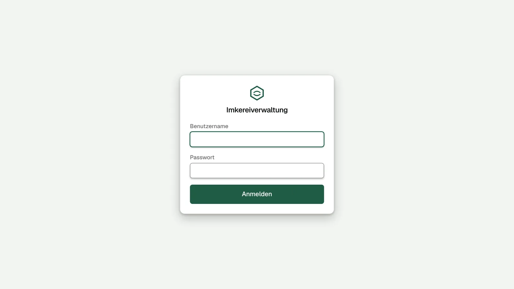

*Die Anmeldeseite.*

**Passwort vergessen?** Helfer mit hinterlegter E-Mail tippen auf der Anmeldeseite auf *Passwort vergessen* und bekommen einen Link, der eine Stunde gilt. Sonst setzt der Hauptzugang unter *Einstellungen → Helfer* ein neues Startpasswort. Für den Hauptzugang selbst gibt es einen Befehl auf dem Server, siehe [Installationsanleitung](https://github.com/frawoer79/Imkerei_Verwaltung/blob/main/installation/LIESMICH.md).

> **Tipp: Auf den Home-Bildschirm legen**  
> Am iPhone/iPad in Safari auf *Teilen* und dann *Zum Home-Bildschirm* tippen (Android/Chrome: Menü, *Zum Startbildschirm hinzufügen*). Dann startet die Imkereiverwaltung wie eine App ohne Adressleiste, und das Handy kann sich Name und Passwort merken.

### Du hast einen Testzugang bekommen?

Manche Betreiber laden Tester per persönlichem Einladungslink ein. Er gilt genau einmal. Öffne ihn, wähle Namen und Passwort, lies den Hinweis zur Testversion und tippe auf **[Zugang einrichten]**. Dabei entsteht deine eigene Datenablage mit dem Beispielstand „Obstwiese“. Niemand sonst sieht deine Daten, aber es gibt keine Garantie für sie. Merk dir danach die Adresse der App, der Einladungslink funktioniert kein zweites Mal.

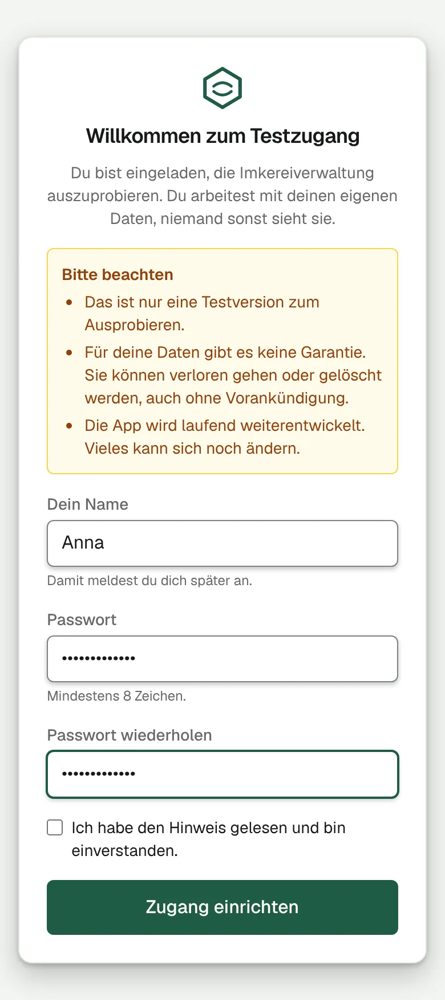 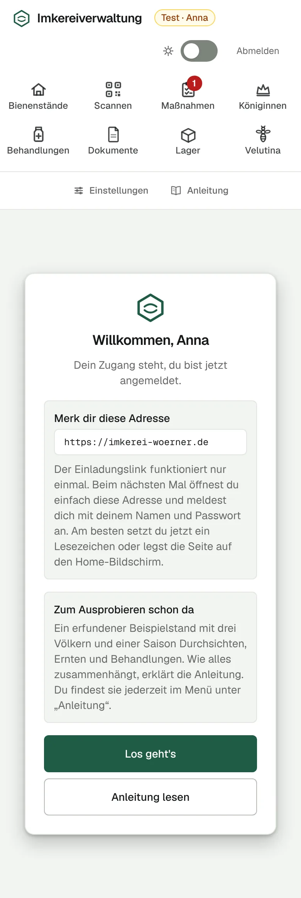

*Die Einladungsseite am Handy.* · *Nach dem Einrichten: Adresse merken, dann Anleitung lesen oder gleich loslegen.*

## Aufbau der App

Wie das Menü aussieht, hängt vom gewählten [Design](#einstellungen) ab. Im Design *Wiese* (Vorgabe) steht es am Rechner links, am Handy oben als Kachelraster. Im Design *Wald* liegt es am Handy als Leiste unten, mit *Scannen* in der Mitte und den übrigen Bereichen unter *Mehr*. Im Design *Bergsee* ist es ein dunkles Band oben, am Handy eine Reihe Reiter. *Einstellungen* und *Anleitung* stehen in allen Designs etwas kleiner und abgesetzt unter dem Hauptmenü. Die Bereiche sind überall dieselben:

| Bereich | Wofür |
|---|---|
| **Bienenstände** | Startseite: deine Stände mit den Völkern darin, von dort geht es zur Stockkarte jedes Volkes. Oben sucht das Feld *Volk suchen* über alle Stände nach Name oder Nummer. |
| **Scannen** | QR-Code an der Beute scannen und direkt die richtige Stockkarte öffnen. |
| **Maßnahmen** | Alles, was zu tun ist, über alle Völker hinweg, als Liste und als Monatskalender. Die rote Zahl zeigt, was heute fällig oder überfällig ist. |
| **Königinnen** | Bestand mit Abstammung (Mutter- und Vaterseite), Begattung, Lebenslauf und Bewertung, dazu die Zuchtplanung. |
| **Behandlungen** | Bestandsbuch für Tierarzneimittel, mit Nachweis als PDF. Dazu Verfahren ohne Medikament wie TBE oder Bannwabe, mit Fahrplan. |
| **Dokumente** | Rechnungen, Gesundheitszeugnisse usw., auf Wunsch mit Stand, Volk oder Königin verknüpft und per E-Mail versendbar. |
| **Lager** | Material (Zargen, Klimadeckel, Mittelwände, Futter) und Erzeugnisse (Honig, Wachs …), auf Wunsch mit Warenwert. Bestandslisten und Buchungen als PDF. |
| **Velutina** | Meldungen der Asiatischen Hornisse rund um deine Stände (nur Baden-Württemberg) und die Nestsuche per Locktopf. |
| **Einstellungen** | Deine Angaben als Bienenhalter, welche Bereiche du nutzt, Design, E-Mail, Beutensysteme, Belegstellen, Lager (Sorten, Gebinde, Preise, Lagerorte), QR-Codes, Kalender-Abo, Helfer, Historie, Updates. |
| **Anleitung** | Diese Anleitung. |

Brauchst du einen Bereich nicht, etwa Zucht oder Lager, blendest du ihn unter *Einstellungen → Bereiche* aus (siehe [Einstellungen](#einstellungen)).

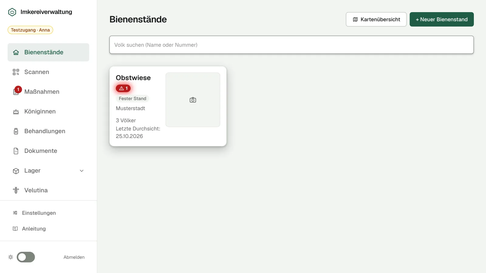 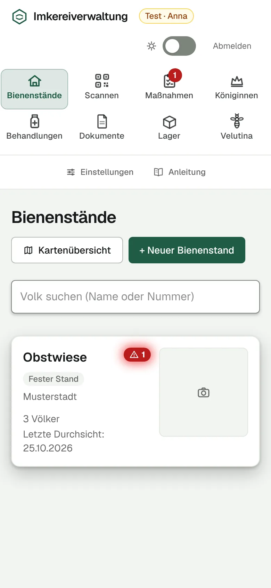

*Am Rechner: Menü links, unten der Hell/Dunkel-Schalter und Abmelden. Das gelbe Abzeichen erscheint nur in Testzugängen. Alle Bilder zeigen das Design Wiese.* · *Am Handy: Menü oben als Kacheln.*

Über jeder Seitenüberschrift steht eine Zeile mit **[← Zurück]** und dem Pfad, z. B. „Bienenstände › Obstwiese“. *Zurück* führt auf die Seite, von der du gekommen bist, ein Tipp auf den Pfad springt direkt dorthin. Mit dem Schalter neben der Sonne wechselst du zwischen heller und dunkler Darstellung. Neben dem Logo steht „Imkereiverwaltung“. Einen eigenen Namen, etwa den deiner Imkerei, trägst du unter *Einstellungen → Bienenhalter* bei *Name im Menü* ein.

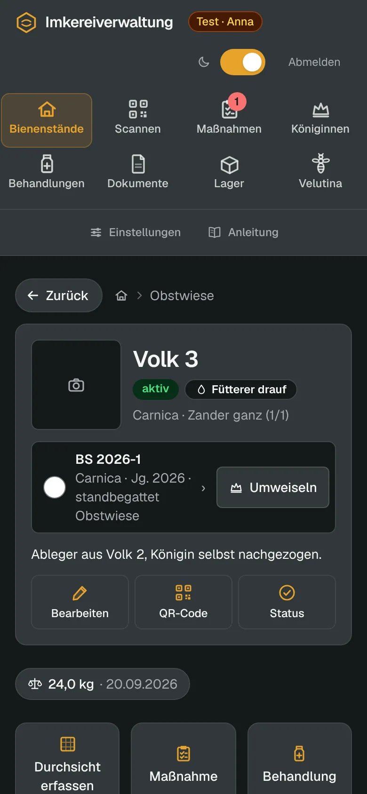 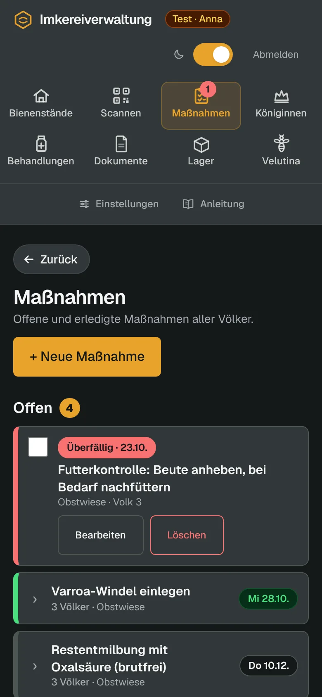

*Dunkle Darstellung am Handy.* · *Maßnahmen, dunkel.*

## Deine ersten Schritte

Nach dem Einrichten ist die App leer. Am schnellsten kommst du so zu deiner ersten eigenen Stockkarte:

1. **Einstellungen → Bienenhalter:** Name, Anschrift und Bundesland prüfen. Das steht später im Kopf des Behandlungsnachweises, und am Bundesland erkennt die App, ob sie dir die Hornissen-Meldungen aus Baden-Württemberg zeigt.
2. **Einstellungen → Beutensysteme:** dein System hinzufügen, z. B. Zander oder Deutsch Normalmaß (siehe unten). Sonst kannst du beim Volk keinen passenden Brutraum wählen.
3. **Bienenstände → Neuer Bienenstand:** deinen ersten Stand anlegen.
4. **Im Stand → Neues Volk:** die Völker anlegen.
5. **Im Volk → Durchsicht erfassen:** die erste Durchsicht festhalten.

Königinnen, Belegstellen, Medikamente und Lager kannst du später nach Bedarf ergänzen.

### Der Beispielstand in den Bildern

Die Bilder dieser Anleitung zeigen den erfundenen Stand **„Obstwiese“** mit drei Völkern und einer Saison Geschichte. Testzugänge bekommen ihn mit. An ihm siehst du, wie die Teile zusammenhängen:

- **Volk 1** ist das starke, sanfte Wirtschaftsvolk. Seine Königin trägt den gelben Stern, zwei Honigernten stehen im Verlauf und im Lager.
- **Volk 2** ging im Mai in Schwarmstimmung. Daraus entstand ein Ableger, die Nachschau steht als erledigte Maßnahme im Verlauf.
- **Volk 3** ist dieser Ableger. Seine Königin hat es selbst nachgezogen, sie stammt laut Abstammung von der Königin aus Volk 2. Im Juli lag Varroa über der Schadschwelle, danach folgt die Ameisensäure-Behandlung aller drei Völker. Der Fütterer liegt noch drauf, und eine Futterkontrolle ist überfällig.

Hast du einen Testzugang, darfst du am Beispielstand alles ändern, ergänzen oder löschen. Brauchst du ihn nicht mehr, archivierst du ihn (Stand öffnen, *bearbeiten*, *Archivieren*). Die Beispielbehandlung bleibt dabei im Bestandsbuch stehen; solange sie existiert, lässt sich der Stand nur archivieren, nicht endgültig löschen.

### Beutensystem hinzufügen

Unter *Einstellungen → Beutensysteme* tippst du auf dein System, etwa **[+ Deutsch Normalmaß]**. Die genormten Rähmchenmaße und Zargen kommen gleich mit, samt einem Richtwert, wie viel Honig eine volle Zarge ungefähr bringt. Klappst du ein System auf, kannst du Wabenzahl und Honigmenge an deine Erfahrung anpassen. Ein System, das nicht in der Liste steht, legst du über *Eigenes System anlegen* an.

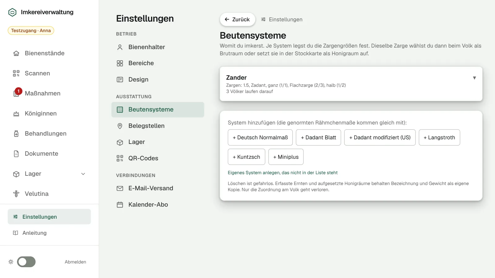 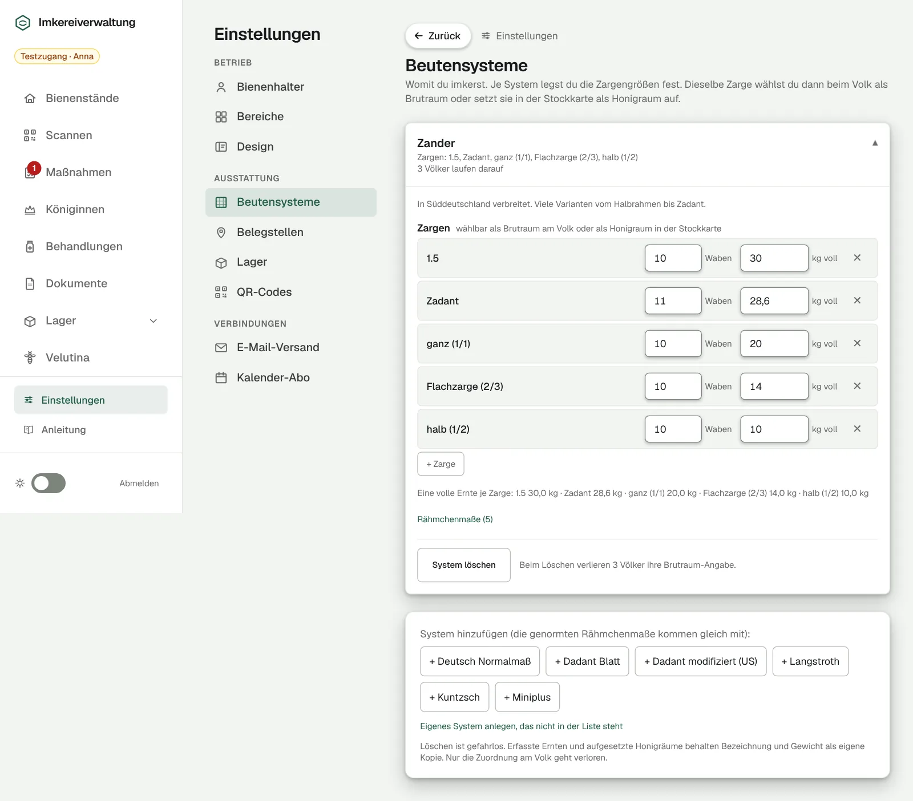

*Auswahl der gängigen Systeme.* · *Zander aufgeklappt: die Zargen mit Wabenzahl und Honig-Richtwert.*

## Bienenstände

### Stand anlegen

Auf der Startseite **[+ Neuer Bienenstand]**. Gib einen Namen ein und wähle die Art:

- **Fester Stand:** dort wird auch überwintert. Auf allen Karten blauer Pin.
- **Wanderstand:** Völker stehen nur vorübergehend dort, z. B. für eine Tracht oder als Ableger. Auf allen Karten gelber Pin.

Den Standort setzt du auf zwei gleichwertigen Wegen: Adresse eintippen und **[Auf Karte suchen]**, oder direkt in die Karte tippen bzw. den Punkt verschieben. Beides füllt das jeweils andere automatisch aus. Mit *Satellit* und *Hybrid* (Luftbild mit Straßen und Ortsnamen) wechselst du die Ansicht, *Vollbild* hilft am Handy beim genauen Setzen. Ein Foto des Standorts ist optional und erscheint später als Bild auf der Kachel.

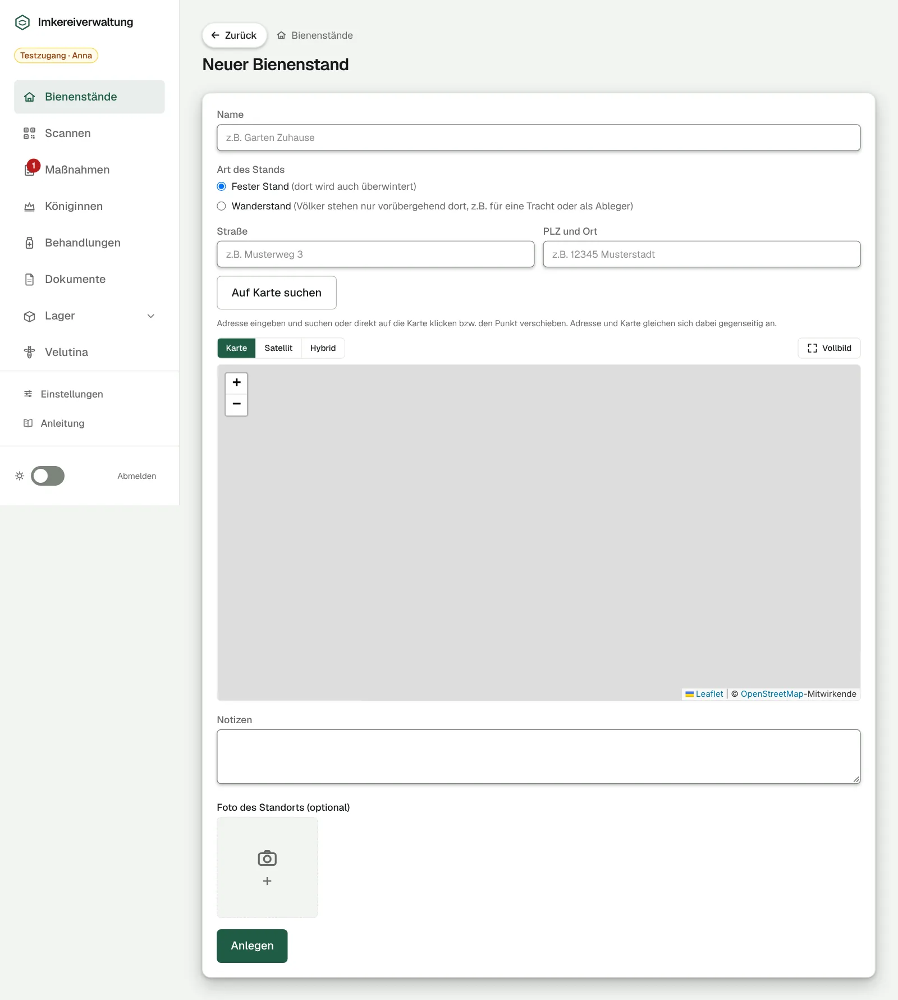

*Neuer Bienenstand (Kartenhintergrund in der Anleitung ausgeblendet).*

### Die Übersicht

Jeder Stand ist eine Kachel mit Art, Ort, Zahl der Völker und Datum der letzten Durchsicht. Die Zahl oben an der Kachel zählt Maßnahmen: **rot** mit Warnzeichen, wenn dort etwas überfällig oder heute fällig ist, sonst unauffällig grau mit allen offenen. Eine Maßnahme für mehrere Völker zählt dabei einmal. Ein Tipp auf die Kachel öffnet den Stand. Über **[Kartenübersicht]** siehst du alle Stände auf einer Karte, mit Flugradius und einer kleinen Legende unten links.

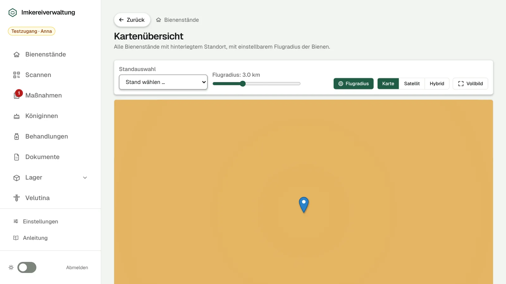

*Kartenübersicht mit Flugradius, oben einstellbar. Die Einstellung merkt sich jedes Gerät.*

### Die Seite eines Stands

Oben stehen Name, Art, Ort und Notizen. Darunter links der Kasten **Asiatische Hornisse** (siehe [Velutina](#velutina)), rechts eine kleine Kartenvorschau. Die Vorschau lässt sich nicht verschieben, ein Tipp darauf öffnet die Kartenübersicht. Am Handy stehen die Völker zuerst, Karte und Hornissen-Kasten weiter unten.

Die Knöpfe **[Durchsicht erfassen]** und **[Maßnahme]** halten etwas für mehrere Völker dieses Stands auf einmal fest (siehe [Mehrere Völker auf einmal](#sammel)). Darunter folgen die **Völker als Kacheln**. Jede Kachel zeigt:

- Zeichenfarbe der Königin als Punkt, Name, Rasse, bei herausragenden Königinnen den Stern;
- Plaketten: Status, **Gesamteindruck** der letzten Durchsicht in Ampelfarbe, *Fütterer drauf*, solange ein Fütterer aufliegt;
- den Kasten **Wertung letzte Durchsicht**: alle Bewertungen der letzten Durchsicht als Text, grün, gelb oder rot gefärbt;
- die offenen Maßnahmen mit Termin. Der Kasten wird rot, wenn etwas überfällig ist, gelb bei „heute fällig“, sonst bleibt er ruhig.

- **Sortierung:** *Chronologisch* (Reihenfolge der Anlage) oder *Standposition*. Bei Standposition schiebst du die Kacheln mit den Pfeilen so, wie die Beuten wirklich nebeneinander stehen.
- **bearbeiten** neben dem Standnamen: Angaben, Standort und Foto ändern, Stand archivieren.
- Ganz unten: **Dokumente** zu diesem Stand.

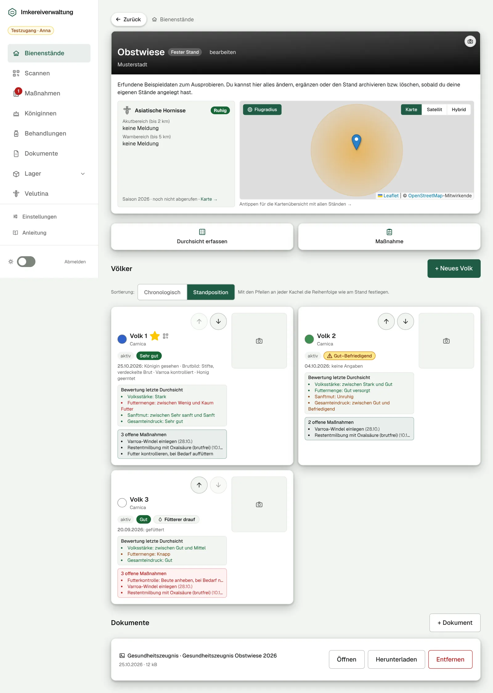 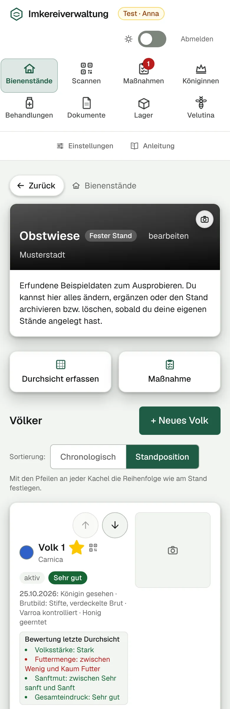

*Stand „Obstwiese“: Bei Volk 3 ist die Futterkontrolle überfällig, deshalb ist sein Maßnahmen-Kasten rot. Der Fütterer liegt noch drauf.* · *Derselbe Stand am Handy.*

> **Archivieren statt löschen**  
> Ein Stand (oder ein Volk), den du nicht mehr brauchst, wird archiviert: Er verschwindet aus den Übersichten, bleibt aber mit allen Stockkarten und Fotos erhalten und lässt sich wiederherstellen. Archivierte Stände findest du unten auf der Startseite. Endgültiges Löschen ist ein eigener Schritt, bei dem du zur Sicherheit den Namen eintippen musst. Völker und Stände mit Behandlungen lassen sich gar nicht löschen, nur archivieren, weil das Bestandsbuch vollständig bleiben muss.

## Völker

### Volk anlegen

Auf der Seite des Stands **[+ Neues Volk]**. Pflicht ist nur der Name bzw. die Stocknummer. Dazu kommen Rasse, Jahrgang und Kennzeichnung der Königin, der **Brutraum** (Zarge aus deinem Beutensystem) mit der **Anzahl** (1 = einräumig, 2 = zweiräumig …), der **Deckel** (Standarddeckel oder ein Klimadeckel aus dem Lager) und optional ein Foto der Beute.

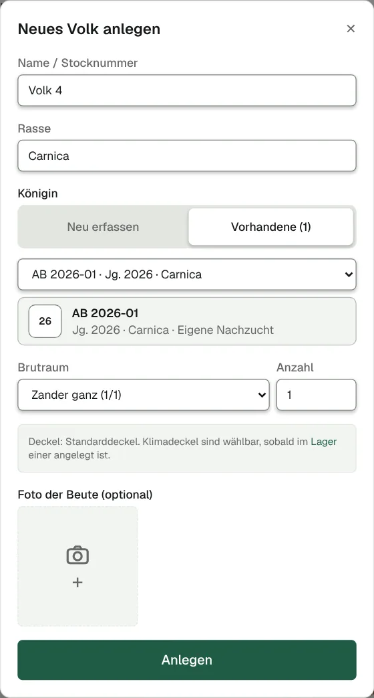

*Neues Volk anlegen, hier mit einer Königin aus dem Bestand.*

> **Königin gleich mit anlegen**  
> Gibst du hier Jahrgang oder Zeichen an, entsteht dazu automatisch eine Königin im Bereich [Königinnen](#koeniginnen). Dort kannst du sie später um Abstammung und Begattung ergänzen.

**Königin aus dem Bestand:** Hast du freie Königinnen (Reserve, in keinem Volk), steht bei der Königin ein Umschalter *Neu erfassen | Vorhandene*. Bei *Vorhandene* wählst du sie aus der Liste. Ein kleiner Steckbrief zeigt Farbe, Zeichen, Rasse und Herkunft. Die Rasse übernimmt die App, solange du keine eigene einträgst. Im Lebenslauf der Königin steht danach „In ein Volk zugesetzt“. Königinnen, die schon in einem Volk sitzen, wählst du hier nicht. Dafür gibt es *Umweiseln* (siehe unten).

### Die Seite eines Volkes (Stockkarte)

Ein Tipp auf die Kachel öffnet das Volk. Der Kopf ist auf allen Geräten gleich aufgebaut:

- Links das Foto der Beute, daneben Name, **Plaketten** (Status, *QR gelernt*, *Fütterer drauf*) sowie Rasse, Betriebsweise (z. B. „2 × Zander ganz“) und ein Klimadeckel, falls vorhanden.
- Darunter eine eigene Zeile für die **Königin**, die gerade im Volk sitzt. Ein Tipp darauf öffnet ihre Seite. Rechts daneben steht **[Umweiseln]**.
- Die Knöpfe **[Bearbeiten]**, **[Umziehen]** (an einen anderen Stand, wird im Verlauf vermerkt; fehlt, solange du nur einen Stand hast), **[QR-Code]** (siehe [QR-Codes](#qr)) und **[Status]** (aktiv, aufgelöst, verkauft oder verloren).

Darunter stehen das zuletzt erfasste **Gewicht** und drei Knöpfe: **[Durchsicht erfassen]**, **[Maßnahme]** und **[Behandlung]**. Alle drei öffnen ihr Formular direkt für dieses Volk.

Hat das Volk **offene Maßnahmen**, stehen sie direkt darunter in einer eigenen Karte. Jede Maßnahme ist ein Kärtchen mit Farbleiste links und Termin: rot überfällig, gelb heute, grün in den nächsten 7 Tagen, grau später. Ab drei Maßnahmen ist die Karte zugeklappt und nennt nur, wie viele überfällig oder heute fällig sind. Ein Tipp klappt sie auf. Ein Haken erledigt sie gleich bei der Durchsicht, ohne Umweg über den alten Eintrag oder die Maßnahmen-Seite. Vertippt? **[Rückgängig]** in der Leiste unten holt sie zurück. Bei einer Maßnahme für mehrere Völker gilt der Haken nur für dieses Volk. Abgehakt wird nur hier, nicht im Verlauf.

### Umweiseln

Setzt du eine neue Königin ein, tippst du in der Königin-Zeile auf **[Umweiseln]**. Im Fenster wählst du das Datum, die neue Königin (aus der Reserve, aus einem anderen Volk oder neu erfasst mit Jahrgang, Zeichen und Herkunft) und was mit der alten geschieht: *Abgedrückt*, *In Reserve / Ableger*, *Verkauft* oder *Verschwunden*. Beide Lebensläufe trägt die App selbst ein. Im Verlauf des Volks erscheint eine Karte „Umgeweiselt alt → neu“. *Bearbeiten* beim Volk ändert die Angaben der jetzigen Königin nur noch zum Korrigieren.

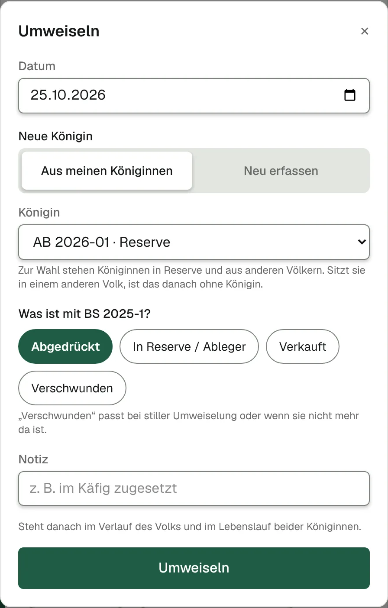

*Umweiseln: neue Königin aus dem Bestand, die alte wurde abgedrückt.*

Es folgt der **Verlauf** auf einer eigenen, leicht getönten Fläche, neueste zuerst und nach Saison gegliedert. Jede Karte hat links einen Farbstreifen: grün für Durchsicht und Königin, grau für Maßnahmen, honigfarben für Behandlungen. Die Kopfzeile jeder Saison fasst zusammen, z. B. „6 Durchsichten · 3 Maßnahmen · 1 Behandlung“, mit der letzten Bewertung, Varroa und Gewicht. Im Verlauf stehen diese Karten:

- **Durchsichten:** Jede Bewertung erscheint als kleiner Strahl mit grüner, gelber und roter Zone, einer Marke und dem Wertungstext, z. B. „Stark“ oder „Gut–Mittel“ (zwischen zwei Stufen). Gelb und rot tragen zusätzlich ein Warnzeichen. Alle übrigen Angaben stehen als kurze Chips darunter, nur was du wirklich ausgefüllt hast. Varroa über der Schadschwelle erscheint als roter Kasten. **[Durchsicht öffnen ›]** rechts oben öffnet den Eintrag.
- **Maßnahmen**, die ohne Durchsicht angelegt wurden: „○ offen“ mit Termin oder „✓ erledigt“. Stift und Mülleimer bearbeiten bzw. löschen sie. Abhaken geht oben unter *Offene Maßnahmen*.
- **Behandlungen** am Tag der Anwendung: Medikament, wogegen, Menge, Dauer und Wartezeit. Den vollständigen Nachweis gibt es unter [Behandlungen](#behandlungen). Verfahren ohne Medikament (TBE, Bannwabe …) erscheinen ebenfalls hier.
- **Königinnenwechsel:** „Umgeweiselt alt → neu“ bzw. „Königin zugesetzt“. Die Saison-Zeile zählt sie mit.

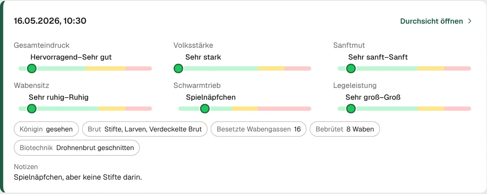

*Eine Durchsicht im Verlauf. Jede Wertung ist ein kleiner Strahl. Die übrigen Angaben stehen als Chips darunter.*

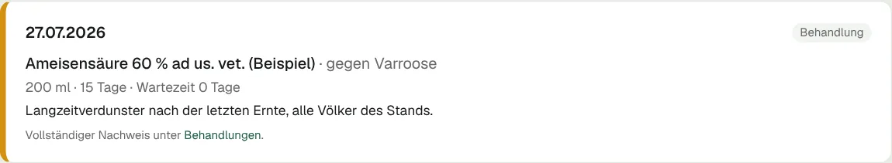 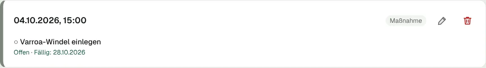

*Eine Behandlung im Verlauf.* · *Eine Maßnahme ohne Durchsicht.*

Fotos im Verlauf öffnest du mit einem Tipp groß. Dort kannst du zoomen, zwischen den Fotos blättern und sie herunterladen; am iPhone legt **[In Fotos sichern]** das Bild direkt in die Fotos-App.

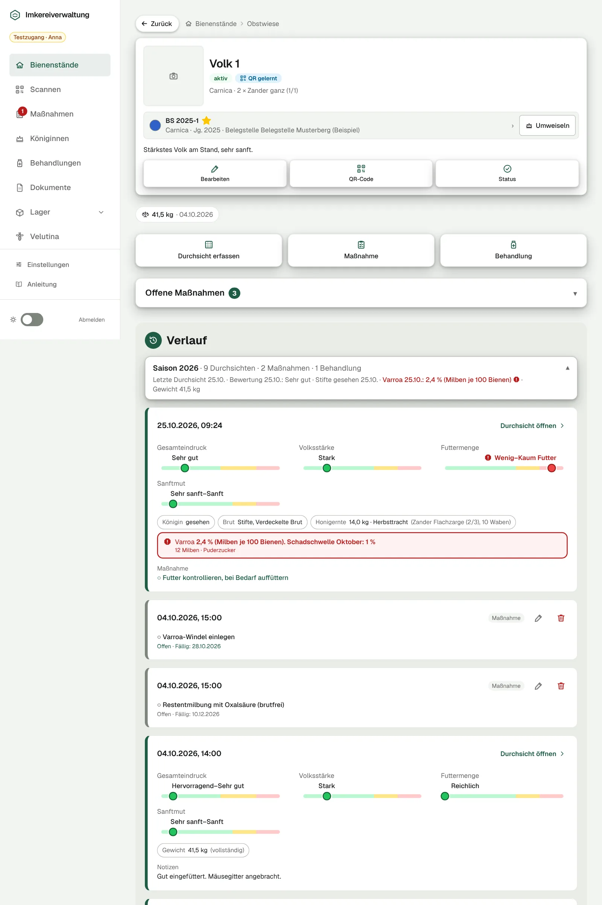 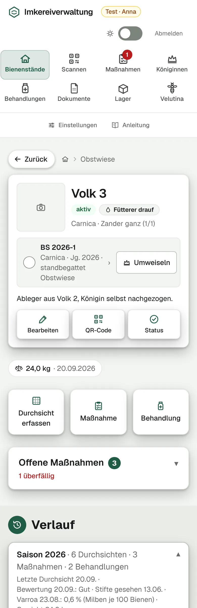

*Volk 1: Kopf mit Königinzeile und Umweiseln, darunter die drei Knöpfe, die offenen Maßnahmen und der Verlauf.* · *Volk 3 am Handy: überfällige Futterkontrolle, Durchsichten als Mini-Strahlen.*

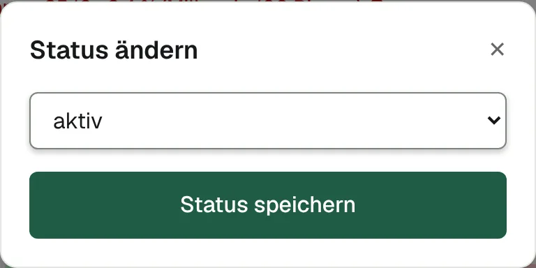

*Status ändern.*

## Durchsicht erfassen

Im Volk auf **[Durchsicht erfassen]** tippen. Datum und Uhrzeit sind auf „jetzt“ gesetzt. Die Angaben sind in aufklappbare Abschnitte gegliedert, Brutraum und Bewertung sind schon offen. **Du füllst nur aus, was du wirklich beobachtet hast**, leere Abschnitte und unberührte Regler bleiben einfach leer. Unten steht immer sichtbar der Knopf **[Durchsicht speichern]**.

| Abschnitt | Was hinein gehört |
|---|---|
| Brutraum | Haken nur für das, was du gesehen hast: Königin, Stifte, Larven, verdeckelte Brut, Weiselzellen, drohnenbrütig. Besetzte Wabengassen und bebrütete Waben stellst du mit + und − ein. Grau steht die Zahl vom letzten Mal; ein Tipp darauf übernimmt sie, das erste + zählt von dort weiter. |
| Waben | Genommene oder gegebene Leerwaben, Mittelwände, Brut- und Futterwaben, Baurahmen, ebenfalls mit „letztes Mal“. |
| Varroa | Zählweise (Puderzucker, Auswaschung, Gemülldiagnose), gezählte Milben, Probengröße bzw. Tage der Windel. Die App rechnet auf Milben je Tag bzw. Prozent um und vergleicht mit der Schadschwelle der Jahreszeit. Unter *Biotechnik* der Haken *Drohnenbrut geschnitten* und ein freies Feld. Verfahren mit Fahrplan wie TBE oder Bannwabe legst du unter [Behandlungen](#behandlungen) an. Tierarzneimittel gehören nicht hierher, sondern unter [Behandlungen](#behandlungen). |
| Bewertung des Volkes | Regler für Volksstärke, Futtermenge, Sanftmut, Wabensitz, Schwarmtrieb, Legeleistung und Gesamteindruck, siehe unten. Dazu die Haken *Bienen haben mich angeflogen* und *Abgeschwärmt*. |
| Honigraum & Ernte | Honigraum aufsetzen oder abnehmen, Ernte (die App schätzt die Menge aus den abgenommenen Zargen und Waben, du kannst sie anpassen) und Honigart. |
| Fütterung | Futterart und Menge in kg, dazu der Haken *Fütterer aufgesetzt*. Er ist so vorbelegt, wie es gerade am Volk ist; nimmst du den Haken weg, gilt der Fütterer als abgenommen. |
| Gewicht | Gewogenes Gewicht, einseitig oder vollständig. Wiegst du in Teilen, tippst du einfach „13+17“, die App rechnet „= 30 kg“. Der Knopf **[+]** neben dem Feld hilft am iPhone, dessen Zahlentastatur kein Plus hat. |

Unten folgen **Notizen**, **Maßnahmen** (eine pro Zeile, sie landen in der [Maßnahmenliste](#massnahmen)) und bis zu fünf **Fotos**, direkt mit der Handykamera oder aus der Mediathek.

### Bewerten mit den Reglern

Jeder Regler hat sechs benannte Stufen, links die beste, rechts die schlechteste, z. B. bei der Volksstärke von „Sehr stark“ bis „Sehr schwach“, beim Schwarmtrieb von „Keiner“ über „Spielnäpfchen“ und „Bestiftet“ bis „Verdeckelt“. Zwischen zwei Stufen kannst du auch die Mitte wählen. Ein Regler ist erst gesetzt, wenn du ihn bewegst; dann färbt er sich grün, gelb oder rot. Das kleine × setzt ihn wieder auf „nicht bewertet“.

Ein grauer, gestrichelter **Ring** zeigt, wo du das Volk beim letzten Mal eingestuft hast, solange der Regler leer ist zusätzlich als Text „Letztes Mal: Stark (04.10.)“. Übernommen wird davon nichts, du entscheidest jedes Mal neu.

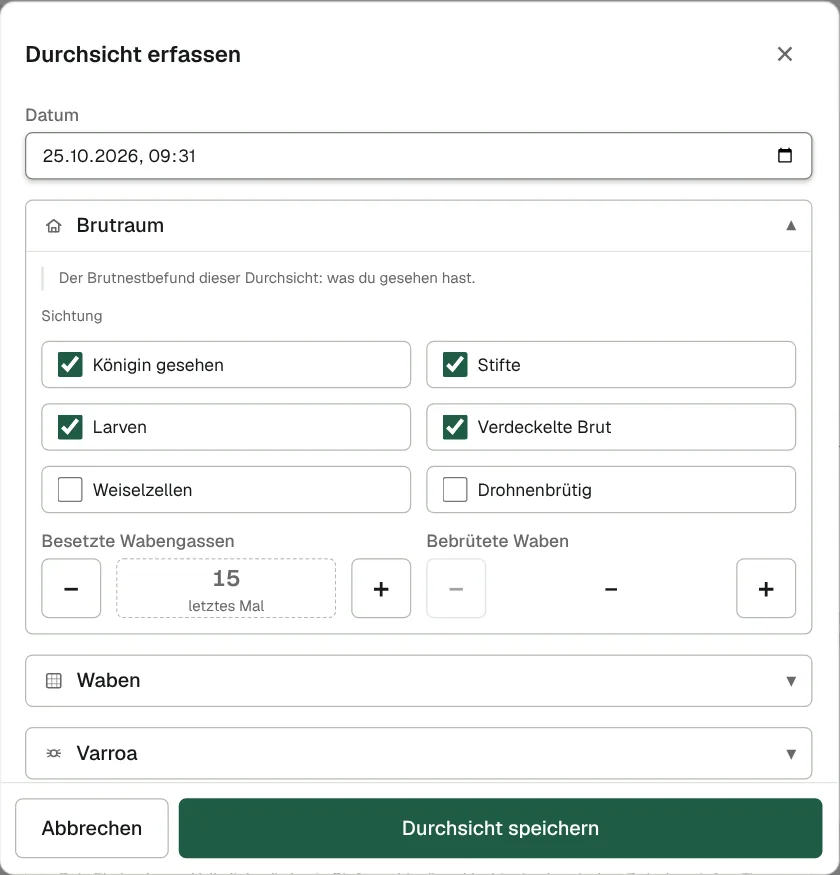 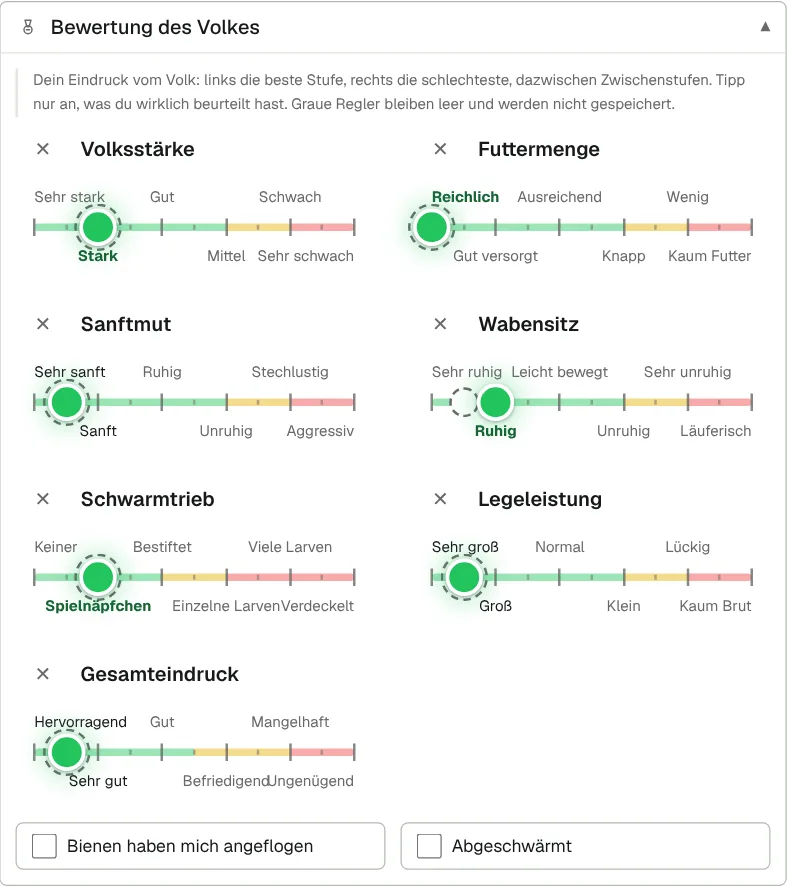 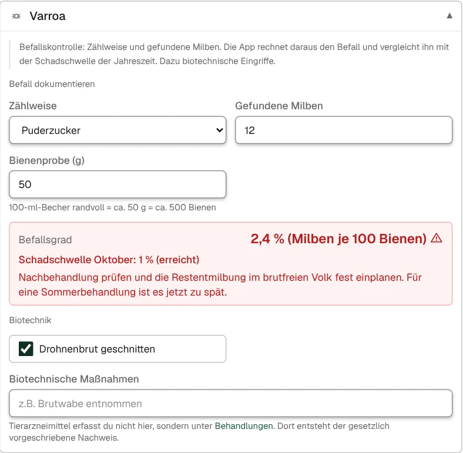 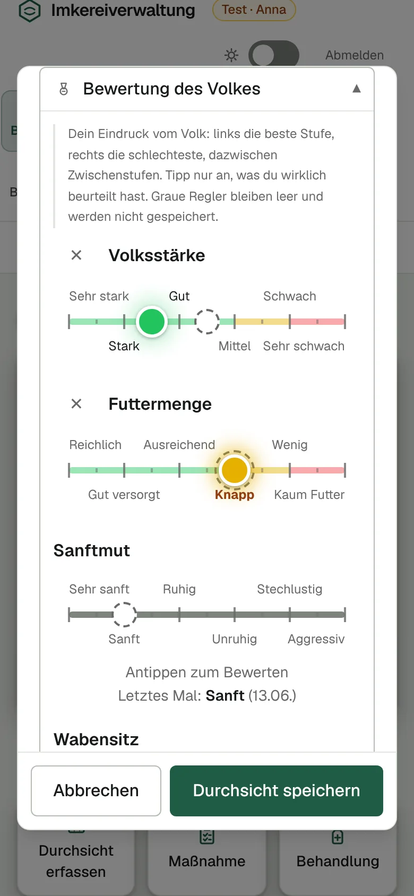

*Brutraum: Haken für das Gesehene, Wabengassen mit „letztes Mal“.* · *Bewertung: sechs Stufen je Regler, der gestrichelte Ring zeigt die letzte Wertung.* · *Varroa: Zählweise und Milben, darunter Biotechnik.* · *Am Handy.*

Drei Abschnitte, die oft gebraucht werden:

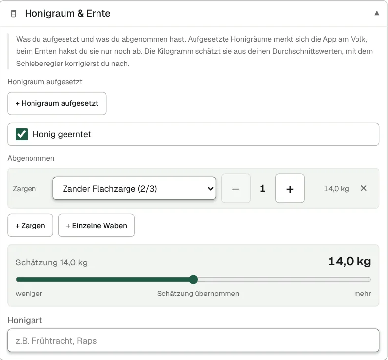 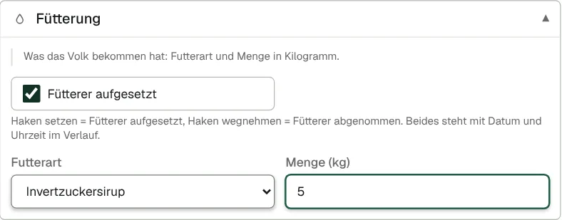 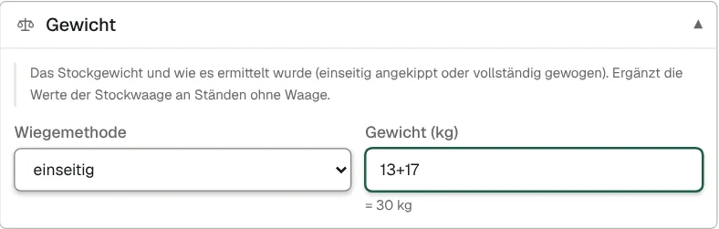

*Ernte: Zarge angeben. Die App schätzt die Menge, der Regler korrigiert.* · *Fütterung: Futterart und Menge. Der Haken sagt, ob der Fütterer drauf ist.* · *Gewicht in Teilen: „13+17“ tippen, die App rechnet.*

### Beim Speichern: kurze Rückfragen

Nach **[Durchsicht speichern]** kann die App bis zu drei kurze Fragen stellen. Nach der letzten Antwort speichert sie sofort, ein zweiter Tipp ist nicht nötig.

1. **Auffälligkeiten:** Ist ein Wert kritisch (z. B. Varroa über der Schadschwelle, sehr wenig Futter, drohnenbrütig, abgeschwärmt), schlägt die App vor, gleich eine Maßnahme mit Termin anzulegen.
2. **Bewertung zur Königin:** Sitzt eine Königin im Volk, fragt die App, ob die Bewertung auch in ihren Lebenslauf soll. Nur mit „Ja“ zählt die Durchsicht für ihre Bewertung, so entscheidest du selbst, was eingeht (z. B. nicht bei einer Durchsicht im Gewitter).
3. **Honig ins Lager:** Bei einer neuen Ernte kannst du die Menge gleich in den Honigbestand im [Lager](#lager) buchen.

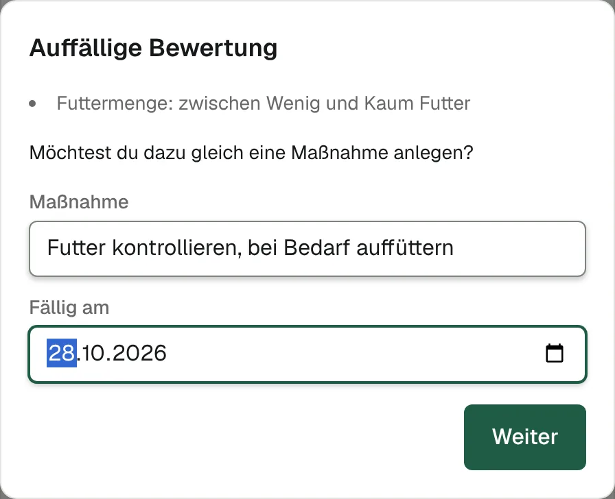 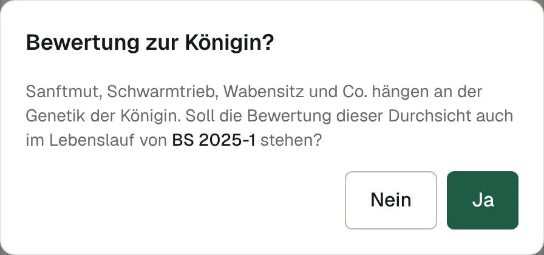 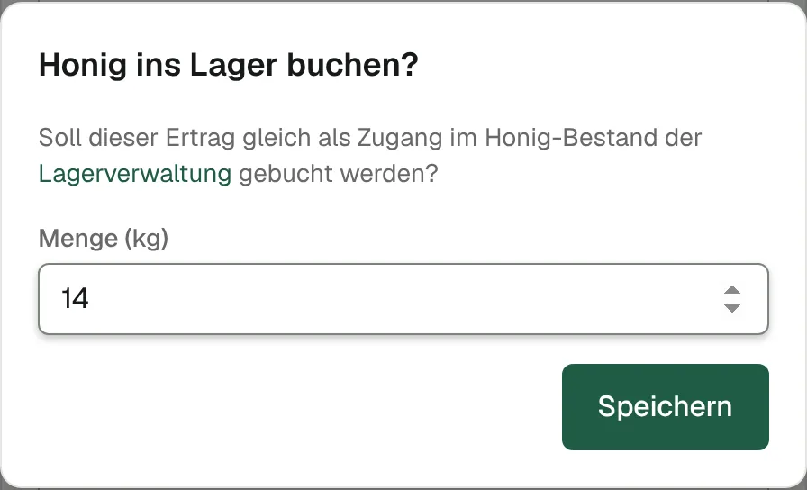

*Auffällig: Die App schlägt eine Maßnahme vor. Text und Termin kannst du ändern.* · *Königin: Nur mit „Ja“ zählt die Durchsicht für sie.* · *Honig: Die Menge ist vorbelegt. „Speichern“ bucht sie ins Lager.*

> **Nichts geht verloren**  
> Während du tippst, sichert das Gerät deine Eingaben laufend als Entwurf. Schließt du das Fenster aus Versehen, ist beim nächsten Öffnen alles wieder da.

### Speichern ohne Netz

Ist beim Speichern kein Netz da oder antwortet der Server nicht, legt die App die Durchsicht samt Fotos auf dem Handy ab. Du siehst kurz *Auf dem Handy gesichert*, tippst **[OK]** und machst am nächsten Volk weiter. Sobald wieder Verbindung da ist, sendet die App alles von selbst, auch wenn du sie erst zu Hause wieder öffnest. Du musst nichts tun.

Das gilt genauso für **neue Maßnahmen** und fürs **Abhaken**: Ohne Netz schließt das Fenster wie gewohnt, eine abgehakte Maßnahme verschwindet aus der Liste. Beides wartet auf dem Handy und geht raus, sobald Netz da ist. Als „erledigt am“ zählt der Moment, in dem du getippt hast.

- **Leiste oben:** etwa „Offline. 2 Durchsichten, 1 Haken warten.“, dann „werden gesendet …“ und zum Schluss kurz „Alles gesendet.“ Antippen zeigt, was noch wartet.
- **Im Verlauf des Volks** steht eine wartende Durchsicht oder Maßnahme als gestrichelte Karte „Wartet auf Senden“. Ist sie angekommen, wird daraus die normale Karte.
- **Langsames Netz:** Dauert das Speichern länger, erscheint **[Weitermachen, im Hintergrund senden]**. Die Durchsicht ist dann schon gesichert.
- **Abgemeldet:** Ist deine Anmeldung abgelaufen, sagt die Leiste „Bitte anmelden“. Nach dem Anmelden geht alles raus.
- **Nicht angenommen:** Lehnt der Server eine Durchsicht ab, etwa weil das Volk inzwischen gelöscht ist, wird die Leiste rot. Du kannst sie *erneut senden*, *ins Formular holen* (Fotos dann neu wählen) oder *verwerfen*.

Doppelt kommt nichts an: Hat der Server schon gespeichert und nur die Antwort ging im Funkloch verloren, erkennt er die Durchsicht wieder.

### Einträge ansehen und korrigieren

**[Durchsicht öffnen ›]** an einer Durchsicht im Verlauf öffnet den Eintrag „Durchsicht vom …“. Er öffnet sich zunächst **zum Lesen**, damit du am Stand nichts aus Versehen verstellst. Zum Ändern legst du oben den Schalter auf *Bearbeiten* um. Dort kannst du auch Fotos ergänzen oder entfernen, Maßnahmen abhaken oder den Eintrag löschen. **[✕ Durchsicht schließen]** oben links (und unten nochmal) bringt dich zurück zu genau dieser Karte im Verlauf.

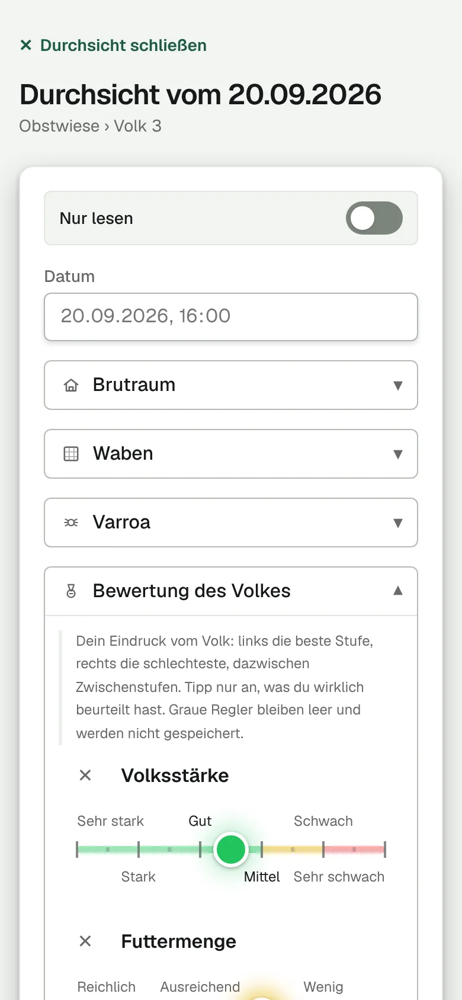

*Der Eintrag ist erst gesperrt. Der Schalter oben gibt ihn frei.*

### Mehrere Völker auf einmal

Wenn du am Stand mehrere Völker gleich behandelt hast, zum Beispiel alle gefüttert oder bei allen eine Windel eingelegt, nimmst du die Knöpfe **[Durchsicht erfassen]** und **[Maßnahme]** auf der **Seite des Stands**.

1. Völker antippen (der farbige Punkt ist die Zeichenfarbe der Königin) oder **[Alle wählen]**. Oben siehst du, wie viele gewählt sind.
2. **[Weiter]**. Über *ändern* neben „Für: …“ kommst du zurück zur Auswahl, deine Eingaben bleiben dabei erhalten.
3. Durchsicht bzw. Maßnahme ausfüllen und speichern. Der Knopf sagt, wie viele Einträge entstehen.

Jedes gewählte Volk bekommt einen eigenen, vollständigen Eintrag in seinem Verlauf bzw. eine eigene Maßnahme. Die Fragen „Bewertung zur Königin?“ und „Honig ins Lager?“ stellt die App nur bei einem einzelnen Volk, weil beides am einzelnen Volk hängt.

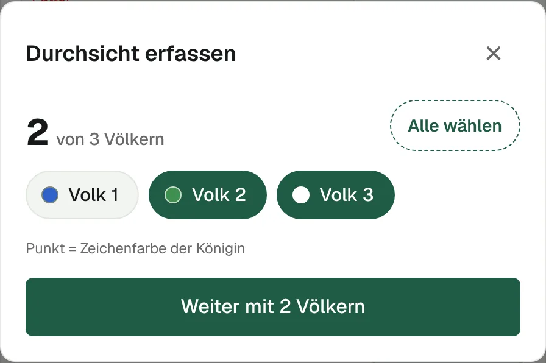 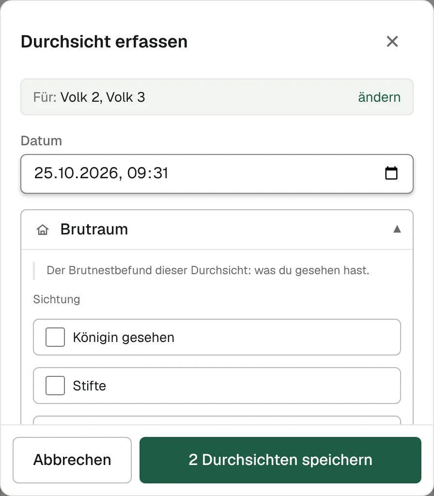 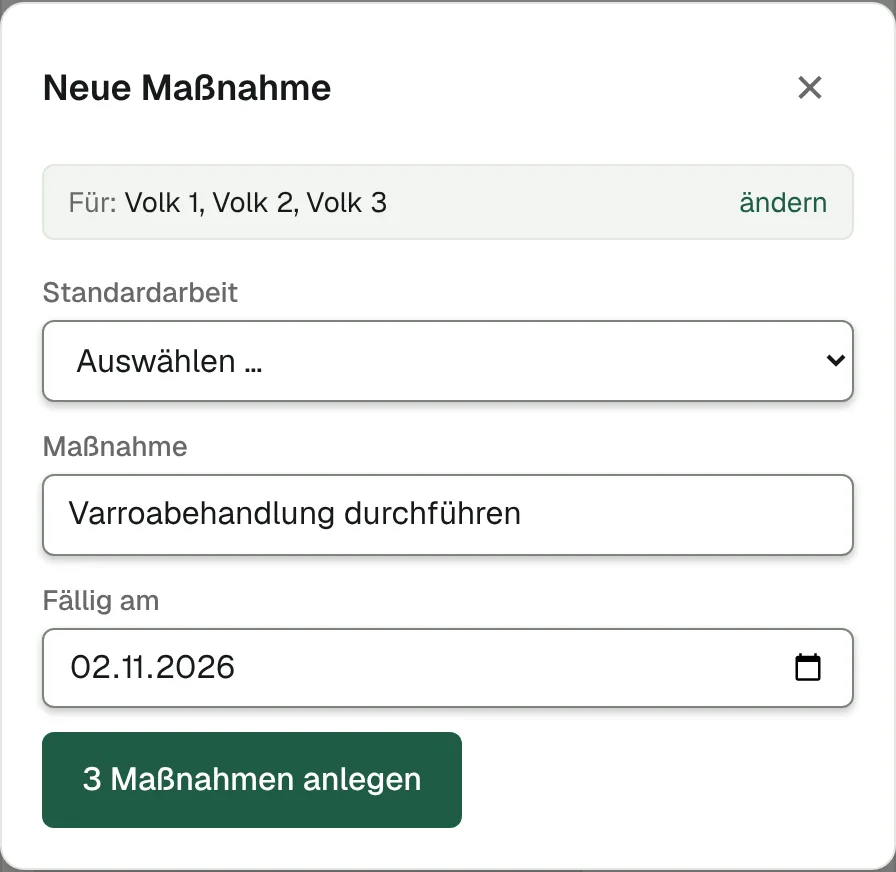

*Auswahl am Stand.* · *Eine Durchsicht „Für: Volk 2, Volk 3“, der Knopf sagt „2 Durchsichten speichern“.* · *Eine Maßnahme für alle drei Völker.*

## Maßnahmen und Kalender

Unter **Maßnahmen** steht alles, was zu tun ist, über alle Völker hinweg, offene oben, erledigte unten. Ein Haken links erledigt eine Maßnahme. Hast du dich vertippt, holt **[Rückgängig]** in der Leiste, die ein paar Sekunden unten erscheint, sie zurück.

- **Farben:** Offene Maßnahmen sind Kärtchen mit Farbleiste links und Termin-Plakette, z. B. „Überfällig · 16.10.“, „Heute“ oder „Fr 23.10.“. Rot ist überfällig, gelb heute fällig, grün in den nächsten 7 Tagen. Später fällige bleiben grau.
- **Sammelmaßnahmen** (eine Maßnahme für mehrere Völker) stehen als eine Zeile, z. B. „3 Völker · Obstwiese · Fällig: 21.10.2026“. Die Zeile zeigt, wie viele schon erledigt sind („1/3 erledigt“). Ein Tipp klappt sie auf: Je Volk eine schmale Zeile mit Haken, Stift und Mülleimer, am Rechner in mehreren Spalten. Mit **[Alle 3 erledigt]** hakst du alle auf einmal ab.
- **Verfahren** ohne Medikament (TBE, Bannwabe …) stehen hier nur, wenn du beim Verfahren *In Maßnahmen übernehmen* angehakt hast. Dann als eine Zeile mit dem nächsten Schritt und Termin. Aufgeklappt siehst du alle Schritte, **[Nächsten Schritt erledigt]** hakt ihn ab.
- **Kalender:** Unter der Liste zeigt ein Monatskalender, an welchen Tagen Maßnahmen anstehen (rot überfällig, gelb heute, grün geplant). Der heutige Tag ist ein gefüllter Kreis. Am Rechner und Tablet siehst du zwei Monate nebeneinander, am Handy einen. Tippst du einen Tag an, zeigt die Liste nur dessen Maßnahmen.

Mit **[+ Neue Maßnahme]** öffnet sich ein Fenster: für **einzelne Völker** (antippen, mehrere möglich), einen **ganzen Stand** oder **alle Stände**. Unter *Standardarbeit* stehen häufige Arbeiten zur Auswahl (z. B. Mäusegitter, Einfüttern), oder du tippst frei ein und setzt einen Termin.

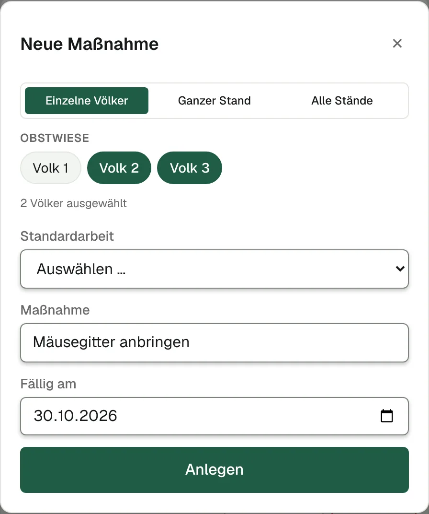

*Eine Maßnahme für Volk 2 und Volk 3, fällig am 30.10.*

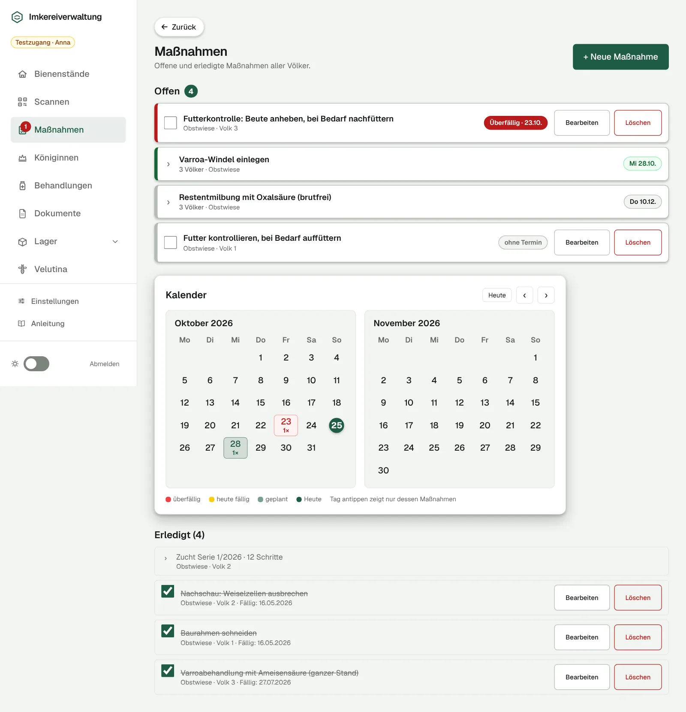

*Maßnahmen: oben die offenen, die Futterkontrolle ist überfällig. Darunter der Kalender und die erledigten.*

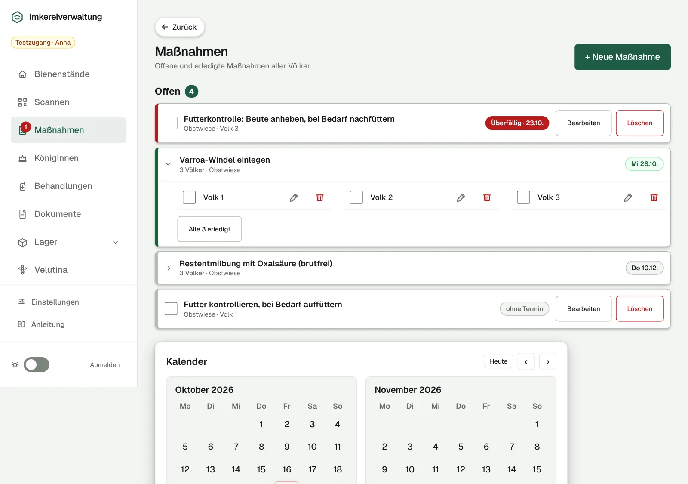 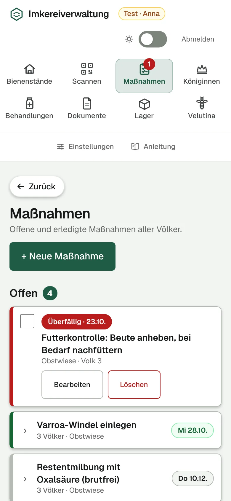

*Die Sammelmaßnahme „Varroa-Windel einlegen“ aufgeklappt.* · *Am Handy.*

### Maßnahmen im eigenen Kalender

Unter *Einstellungen → Kalender-Abo* bekommst du eine persönliche Kalenderadresse. Abonnierst du sie im Kalender von iPhone, iPad oder Rechner, erscheinen alle offenen Maßnahmen mit Termin dort, samt Erinnerung, ohne dass du die App öffnen musst. Die genaue Anleitung fürs iPhone steht auf der Seite zum Aufklappen. Erinnerungszeit, Farbe und Titel der Termine stellst du darunter ein.

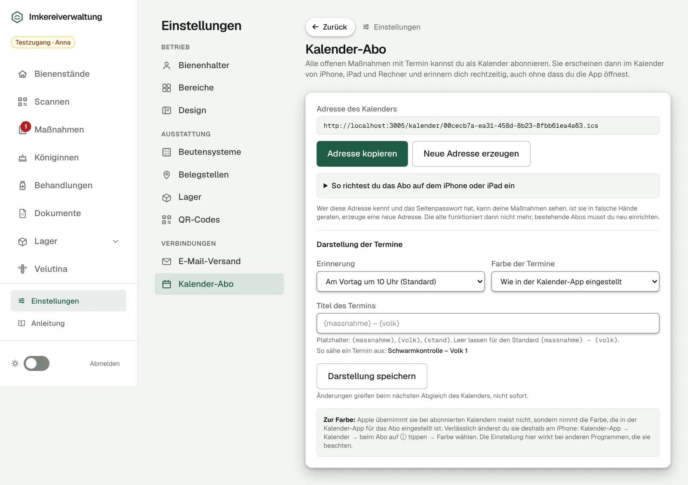

*Kalender-Abo einrichten. Die Adresse ist persönlich, gib sie nicht weiter. Mit Neue Adresse erzeugen machst du eine bekannt gewordene Adresse ungültig.*

## Königinnen

Der Bereich hat zwei Reiter: **Bestand** (alle Königinnen) und **Zucht** (Zuchtserien, siehe [Zucht](#zucht)).

### Bestand

Die Liste ist nach Ständen gruppiert; Königinnen ohne Volk (Reserve, Ableger, im Käfig) und nicht mehr vorhandene stehen am Ende. Das farbige Quadrat zeigt Zeichenfarbe und Jahrgang. Mit Suche und Filtern (Stand, Jahrgang, Begattung) findest du schnell die richtige, mit *Liste / Kacheln* wechselst du die Ansicht. Den gelben **Stern** setzt du selbst auf der Seite einer Königin, um herausragende Tiere zu markieren.

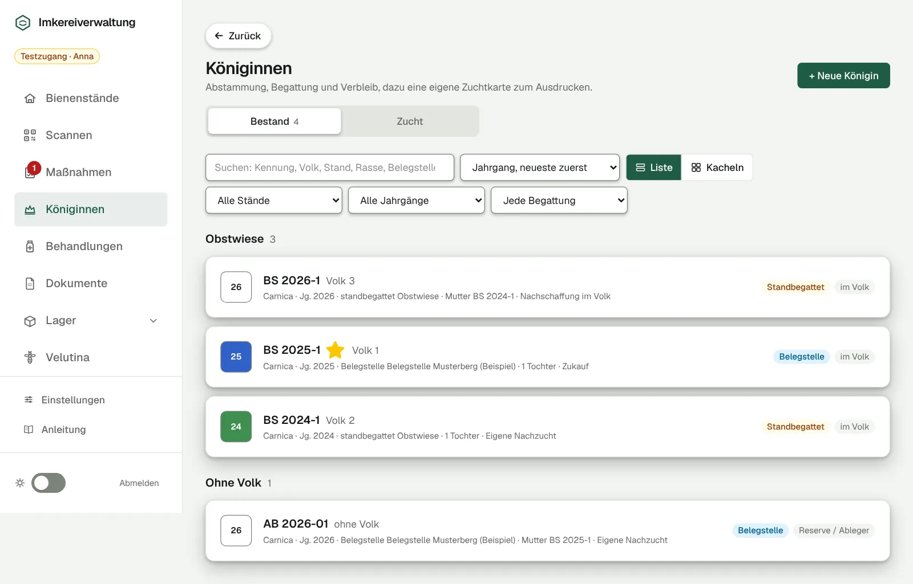 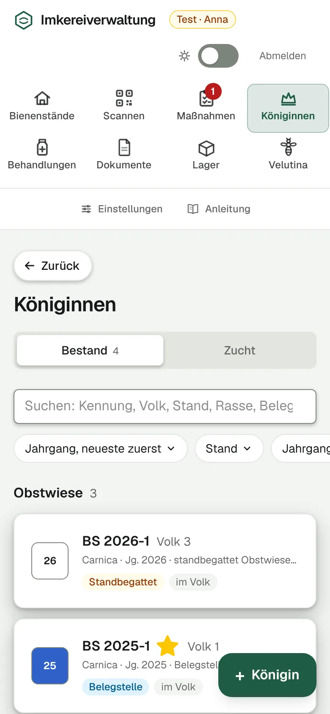

*Die drei Königinnen des Beispielstands.* · *Am Handy: Filter als Chips, + Königin als schwebender Knopf.*

### Neue Königin

**[+ Neue Königin]**. Eine Kennung wird vorgeschlagen. Dazu kommen Jahrgang und Zeichen (die Farbe richtet sich nach dem Jahrgang), Herkunft (eigene Nachzucht, Nachschaffung, Schwarm, Zukauf), Mutter, Begattung (Belegstelle, Standbegattung, künstliche Besamung) und das Volk, in das sie kommt. Belegstellen legst du einmal unter *Einstellungen → Belegstellen* an, dort auch die Drohnenvölker je Jahr.

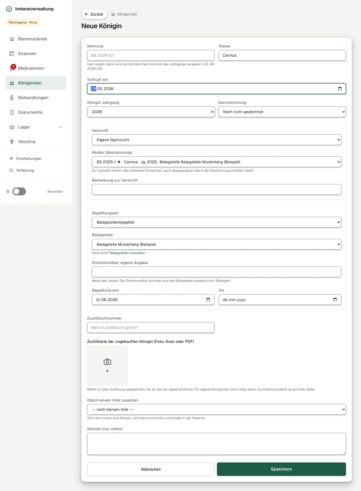

*Neue Königin anlegen.*

### Seite einer Königin

- **Stammdaten** und darunter die **Bewertung**: der Schnitt aller übernommenen Durchsichten je Kriterium als Note (1 ist die beste), eine Gesamtnote, dazu Honigertrag und Brutwaben. Nur hier bei den Königinnen stehen Noten, damit sich Königinnen vergleichen lassen; auf Stockkarte und Stand siehst du die Wertungstexte.
- **Abstammung** mit *Mutterseite* und *Vaterseite*, dazu die Töchter. Die Vaterseite zeigt bei Belegstellen-Begattung die Belegstelle, das Belegjahr und die Drohnenvölker, die dort in diesem Jahr standen. Bei künstlicher Besamung die Vaterlinie, bei Standbegattung „Drohnen unbekannt“. Das Belegjahr ist das Jahr von „Begattung von“, sonst der Jahrgang. *Ganzer Stammbaum* zeigt alle Linien, jede Königin mit „♂ Belegstelle Jahr“.
- **Lebenslauf**: Schlupf, Belegstelle, Zusetzen, Entnehmen, Verkauf, Tod und Bewertungen. Einzelne Kriterien einer Bewertung kannst du abhaken, wenn sie verfälscht waren.
- **Zuchtkarte**: einmal erstellen (die Vaterseite ist mit den Drohnenvölkern vorbelegt), bei Bedarf anpassen und drucken (mehrere Karten auf einem Bogen über *Dokumente → Zuchtkarten drucken*).

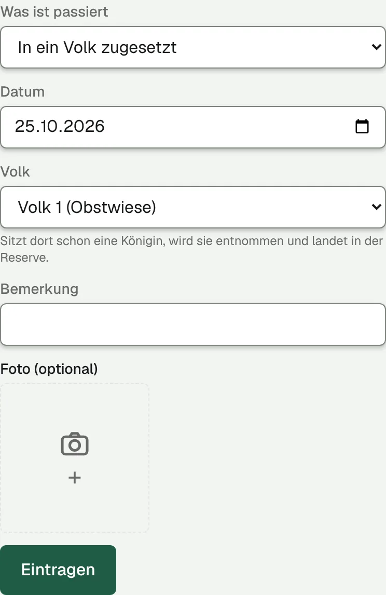

*Lebenslauf: Ereignis, Datum und Volk wählen. Sitzt dort schon eine Königin, kommt sie in die Reserve.*

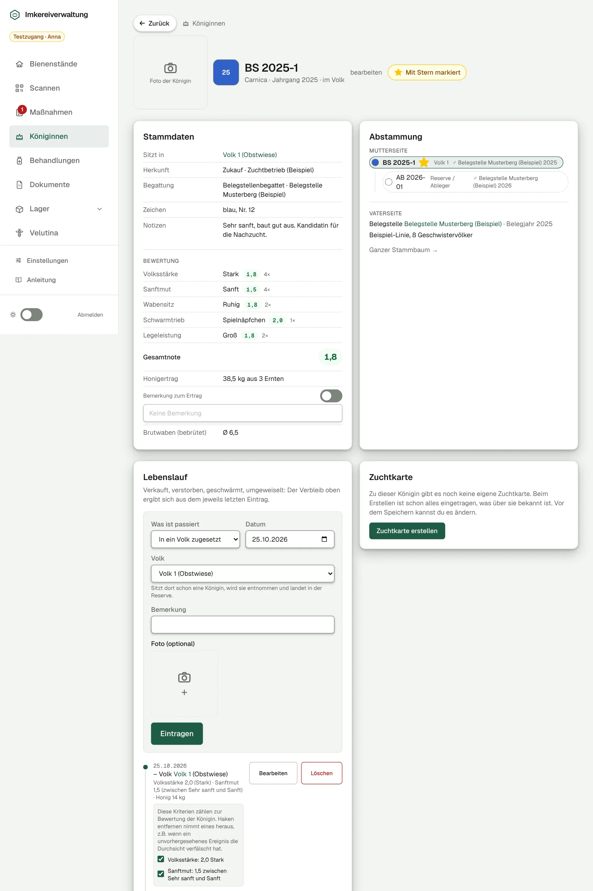

*Die Königin aus Volk 1 mit Stern, Bewertung und Abstammung mit Vaterseite.*

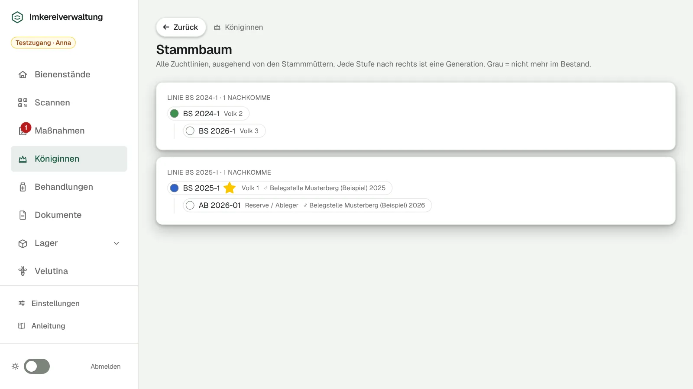

*Der Stammbaum über alle Generationen. ♂ zeigt Belegstelle und Belegjahr.*

## Zucht

Unter *Königinnen → Zucht* planst du Zuchtserien. Bei **[+ Neue Serie]** wählst du Zuchtmutter, Zuchtvolk, Pflegeverfahren (z. B. weiselloses Pflegevolk, Starter/Finisher, Brutschrank), Pflegevolk, Umlarvtag und die geplante Begattung.

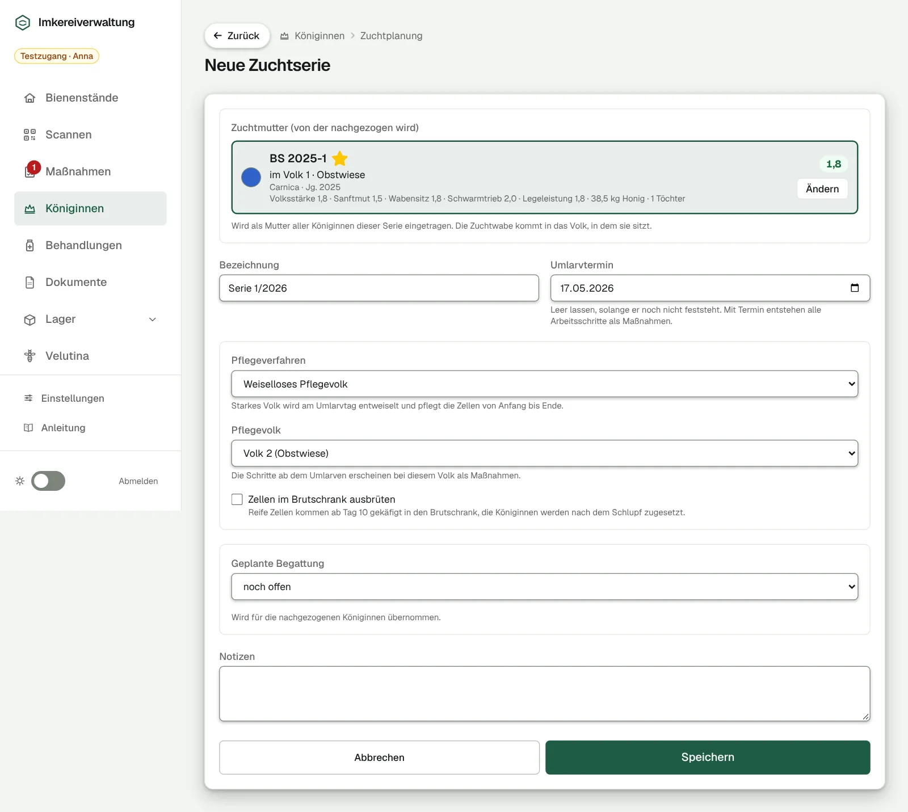

*Neue Zuchtserie: die Zuchtmutter mit ihren Noten auswählen.*

Aus dem Umlarvtag errechnet die App den ganzen **Zeitplan**: Pflegevolk vorbereiten, Annahme kontrollieren, verschulen, Schlupf, Begattung, Eilage. Jeder Schritt erscheint als Maßnahme beim jeweiligen Volk und auf Wunsch im Kalender-Abo. Rechts trägst du die **Zahlen** nach (umgelarvt, angenommen, verdeckelt, geschlüpft). Nach dem Schlupf legst du unten die **nachgezogenen Königinnen** in einem Rutsch an, Mutter und Jahrgang sind dann schon eingetragen.

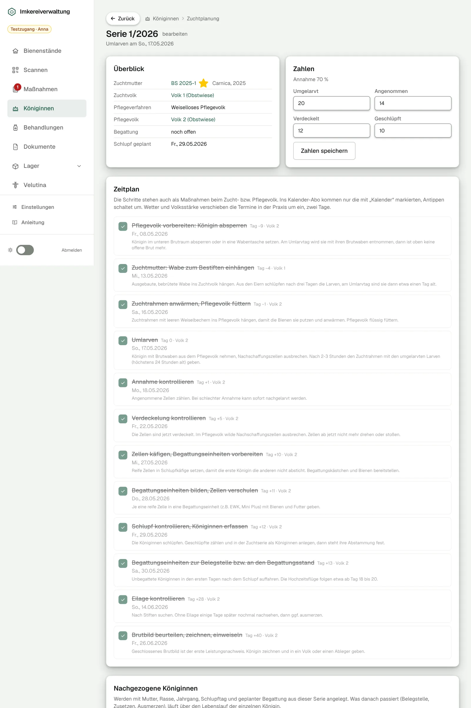

*Eine Zuchtserie mit Überblick, Zahlen und Zeitplan.*

## Behandlungen (Bestandsbuch)

Hier dokumentierst du die Anwendung von Tierarzneimitteln, so wie es das Bestandsbuch verlangt.

1. **Medikament anlegen** (**[Medikamente]** → *Medikament anlegen*): Name, Wirkstoff, Zulassungsnummer, Wartezeit, Charge, Verfallsdatum. **Lieferant und Belegnummer** sind Pflicht. Für die gängigen Varroa-Mittel gibt es **Vorlagen**: Unter *Gängige Mittel als Vorlage* tippst du beim Mittel auf **[Aktivieren]**. Name, Wirkstoff, Einheit und Wartezeit sind dann schon ausgefüllt. Du trägst nur noch deine Packung ein: Lieferant, Belegnummer, Kaufdatum und Charge. Diese vier sind bei einer Vorlage Pflicht. Gleiche die Angaben kurz mit der Packung ab. Lade die Rechnung oder Verschreibung als **Erwerbsbeleg** hoch, sie gehört zum Nachweis. Fehlt etwas, zeigt die App das beim Medikament und oben in der Übersicht an.
2. **Behandlung erfassen** (**[+ Neue Behandlung]**, oder auf der Volk-Seite **[Behandlung]**). Oben steht der Umschalter *Mit Medikament | Ohne Medikament*. Mit Medikament: Medikament, behandelt gegen (z. B. Varroose), Völker (einzeln oder ganzer Stand), Datum, bei Langzeitverdunstern das Ende, Menge je Volk (Komma erlaubt) und Anwender. Die App nennt dir den Tag, ab dem frühestens wieder Honig entnommen werden darf.
3. **Nachweis als PDF**: Jahr und Umfang wählen, **[PDF erstellen]**. Die Datei bleibt gespeichert und lässt sich jederzeit wieder herunterladen oder verschicken.

Die dokumentierten Behandlungen sind nach Jahren in Reitern sortiert. Jede Behandlung erscheint außerdem im Verlauf der behandelten Völker.

### Verfahren ohne Medikament

Bei *Ohne Medikament* wählst du ein Verfahren: **Totale Brutentnahme (TBE)**, **Teil-Brutentnahme**, **Bannwabenverfahren**, **Königin käfigen** oder **Sonstiges**. Dazu Völker und Beginn. Menge und Wartezeit entfallen, ins Bestandsbuch kommt es nicht.

- **Fahrplan:** Aus dem Beginn rechnet die App alle Schritte mit Tag und Termin, etwa Brut entnehmen, Befall kontrollieren oder die Oxalsäure-Behandlung danach.
- **Bannwabe:** Unter *Ablauf* wählst du 3 × 9 Tage (LWG Bayern, Vorgabe), 3 × 7 Tage (apisuisse), 4 × 7 Tage oder 2 × 12 Tage als Doppeltasche (12/24).
- **In Maßnahmen übernehmen:** Angehakt stehen die Schritte auch unter [Maßnahmen](#massnahmen), im Kalender und im Kalender-Abo. Sonst nur beim Verfahren und im Verlauf am Volk.
- **Seite des Verfahrens:** Fahrplan mit Haken je Schritt, für alle Völker auf einmal. Beim Medikamenten-Schritt öffnet **[Behandlung eintragen]** das Formular schon ausgefüllt und hakt den Schritt danach ab. *Bearbeiten* verschiebt die offenen Termine mit.

Verfahren stehen in der Liste unter Behandlungen und im Verlauf der Völker. Käfigen und Bannwabe trägt die App auch in den Lebenslauf der Königin ein.

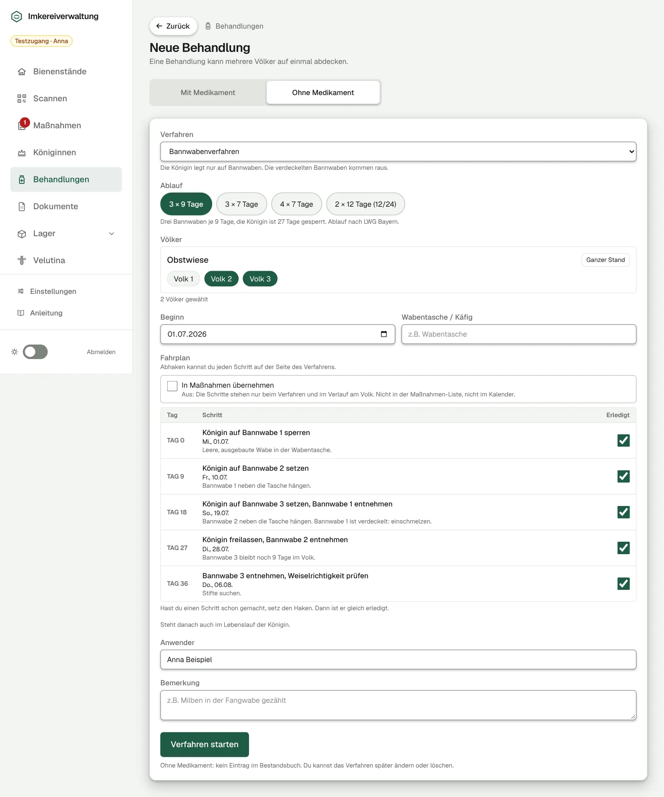 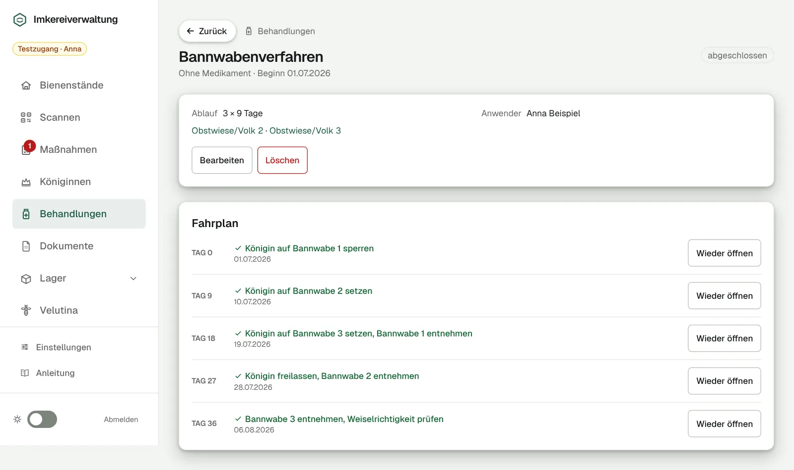

*Bannwabenverfahren für Volk 2 und Volk 3 mit Fahrplan. Erledigte Schritte hakst du gleich mit ab.* · *Die Seite des Verfahrens mit allen Schritten.*

 

*Medikamente: bei den Beispielmedikamenten fehlt der Beleg.* · *Medikament anlegen. Lieferant und Belegnummer sind Pflicht.*

*Neue Behandlung. Oben der Umschalter Mit/Ohne Medikament.*

*Übersicht: Hinweise auf fehlende Angaben, PDF-Nachweis und die Ameisensäure-Behandlung des Beispielstands.*

*Der Nachweis in der Vorschau: oben die Übersicht je Volk, darunter jede Anwendung einzeln.*

> **Stornieren statt löschen**  
> Eine falsch erfasste Behandlung wird storniert (mit Grund), nicht gelöscht. So bleibt der Nachweis lückenlos. Stornierte Behandlungen erscheinen nicht mehr im Verlauf des Volkes, wohl aber im Bestandsbuch.

## Dokumente

Bilder und PDFs mit Kategorie (Gesundheitszeugnis, Rechnung, Vertrag, Versicherung, Genehmigung, Anleitung, Sonstiges oder eigene). Beim Hochladen kannst du ein Dokument mit einem Stand, einer Königin und/oder mehreren Völkern verknüpfen. Es erscheint dann zusätzlich dort. Die Liste lässt sich durchsuchen und nach Kategorie filtern. Hier liegen auch die erzeugten Behandlungsnachweise, die Lagerlisten, die Medikamenten-Belege und der Druck der Zuchtkarten.

**Per E-Mail senden:** Hast du unter *Einstellungen → E-Mail-Versand* dein Postfach eingerichtet, bekommt jede Zeile ein Kästchen. Wähle die Dokumente aus und tippe auf **[Per E-Mail senden]**: Empfänger, Betreff und Text eintragen, auf Wunsch eine Kopie an dich. Die Dateien hängt die App selbst an.

 

*Dokument hochladen und mit dem Stand verknüpfen.* · *Die Dokumentenliste.*

## Lager

Tippst du im Menü auf *Lager*, klappt darunter eine Auswahl auf: *Material* oder *Erzeugnisse*. Am Rechner klappt „Lager“ in der Seitenleiste auf und bleibt offen, solange du im Lager bist. Oben auf beiden Seiten wechselst du mit dem Umschalter direkt zur anderen.

**Material:** Bei den Zargen trägst du den Gesamtbestand ein. Wie viele davon im Einsatz sind, rechnet die App selbst aus Bruträumen und aufgesetzten Honigräumen aus. Genauso bei den **Klimadeckeln**: Gesamtbestand eintragen, „im Einsatz“ zählt die Völker, denen du den Deckel zugeordnet hast. Sonstiges Material (Mittelwände, Futter, Gläser …) legst du frei mit Menge, Einheit und Lagerort an.

### Erzeugnisse

Je Erzeugnis gibt es einen Chip: Honig, Wachs, Propolis, Pollen und eigene. Darunter steht der Bestand als Liste. Ein Posten ist ein Gebinde mit Sorte, Zustand und Lagerort, z. B. „Eimer 25 kg · Frühtracht · 2 Stück“. Was nicht in einem Gebinde liegt, steht als lose Menge darunter: bei kg und g als „Gewicht“, bei Stück oder Liter als „Menge“. Stückzahlen zeigt die App ohne Komma.

**Sortieren:** Ab zwei Posten wählst du neben dem Einlagern-Knopf *Sortieren nach Sorte | Gebinde*. Je Gruppe steht eine Zwischenzeile mit der Summe. Nach Gebinde kommen Eimer, Gläser, Sonstige und zuletzt die lose Menge. Jedes Gerät merkt sich deine Wahl.

1. **Einlagern: [+ Honig einlagern]** tippen. Oben *Eimer*, *Gläser* oder *Gewicht* antippen, darunter die Größe. Fehlt eine Größe, legst du sie mit „+ Größe“ an, z. B. „400 g“. Dann Anzahl, Sorte, Lagerort und Grund (Ernte, Zukauf, Bestandskorrektur, Sonstiges) wählen. Der Lagerort ist mit dem vom letzten Mal vorbelegt. Zustand, Datum und Notiz stehen unter „Weitere Angaben“.
2. **Auslagern:** Beim Posten auf **[Auslagern]** tippen. Anzahl und Grund wählen, fertig. Mehr als vorhanden geht nicht.
3. **Abfüllen:** Beim Posten, aus dem du abfüllst, auf **[Auslagern]** tippen und den Grund *Abfüllen* wählen. Mit + zählst du die gefüllten Gläser. Die App bucht sie ein. Ein angebrochener Rest bleibt unter „Gewicht“ stehen.

  

*Einlagern: 2 Eimer Frühtracht aus der Ernte, in den Keller.* · *Auslagern: 4 Gläser verkauft. Unten steht, was übrig bleibt.* · *Abfüllen: 12 Gläser aus einem Eimer. Die App rechnet den Rest aus.*

Honig aus einer Ernte musst du nicht von Hand buchen. Die Durchsicht fragt beim Speichern danach. Ein eigenes Erzeugnis legst du mit **[+ Neu]** am Ende der Chips an (Name und Einheit kg, g, Stück oder Liter). Eigene Erzeugnisse lassen sich darunter umbenennen und löschen, löschen aber nur ohne Bestand. Honig, Wachs, Propolis und Pollen bleiben fest. Sorten, Gebinde, Preise und den Schalter „Eimer einzeln wiegen“ findest du unter *Einstellungen → Lager*.

**Eimer einzeln wiegen:** Ist der Schalter an, fragt das Einlagern je Eimer nach dem echten Gewicht (leer = Nennwert). Jeder Eimer bekommt eine Nummer. Die Liste zeigt Anzahl und echtes Gewicht, **[Gewichte]** klappt die einzelnen Eimer auf. Ältere Eimer ohne Gewicht wiegst du dort mit **[Nachwiegen]** nach. Beim Auslagern und Abfüllen hakst du an, welche Eimer es sind. Abfüllen schlägt Gläser der größten Größe vor. Der Rest bleibt im Eimer, kommt unter „Gewicht“ oder wird als Schwund ausgebucht. Gläser zählen immer nach Nennwert.

**Warenwert:** Schaltest du unter *Einstellungen → Lager* den Warenwert an, zeigt jeder Posten seinen Wert, z. B. „50 × 4,50 € = 225,00 €“. Die Zwischenzeilen tragen die Summe, darunter steht der Wert des Erzeugnisses und aller Erzeugnisse. Posten ohne Preis zählen nicht mit, ein Hinweis sagt das. Beim Einlagern steht dann ein Feld *Preis je Stück* bzw. *Preis je kg*, vorbelegt aus der Preisliste. Änderst du ihn, ändert sich die Preisliste für diese Sorte und Größe.

**Lagerlisten: [PDF erstellen]** neben Material bzw. Bestand erzeugt eine Bestandsliste mit Lagerorten und dem, was gerade an den Völkern im Einsatz ist. Mit Warenwert kommen Preis und Wert dazu, bei Honig eine Tabelle „Warenwert nach Sorte“. Bei Einzelgewichten stehen die Eimer einzeln darunter. **Buchungen als PDF** unten bei den Erzeugnis-Lagerlisten: Zeitraum (Vorgabe 1.1. bis heute) und Erzeugnis wählen. Das PDF zeigt Anfang, Zugänge, Abgänge und Ende, dazu jede Buchung, älteste zuerst. Alle PDFs liegen unten auf der jeweiligen Lager-Seite und unter Dokumente.

*Erzeugnisse mit eingeschaltetem Warenwert, nach Sorte sortiert: je Posten Anzahl × Preis, unten die Summe.*

*Material: Zargen mit „im Einsatz“ und „verfügbar“, Klimadeckel, sonstiges Material.*

## QR-Codes und Scannen

Mit einem QR-Aufkleber an jeder Beute öffnest du am Stand per Scan sofort die richtige Stockkarte.

1. **Codes erzeugen:** *Einstellungen → QR-Codes*, Anzahl wählen, PDF-Bogen öffnen und über den Drucken-Befehl des Browsers drucken. Fertige QR-Karten aus dem Handel funktionieren ebenso.
2. **Anlernen:** Auf der Volk-Seite den Knopf **[QR-Code]** tippen und den Aufkleber scannen. Gehört der Code schon zu einem anderen Volk, fragt die App nach. Danach trägt das Volk die Plakette *QR gelernt*.
3. **Ändern oder entfernen:** Ist schon ein Code angelernt, öffnet derselbe Knopf *QR-Code bearbeiten*. **[Neuen anlernen]** ersetzt den alten Code, **[Code löschen]** trennt ihn nach einer Rückfrage vom Volk.
4. **Scannen:** Menüpunkt *Scannen* öffnet die Kamera und springt zur Stockkarte. Selbst erzeugte Codes funktionieren auch mit der normalen Kamera-App des Handys.

> **Kamera fragt jedes Mal?**  
> Safari am iPhone und iPad fragt ab Werk bei jedem Scan neu nach der Kamera. Dauerhaft erlaubst du sie in der *Einstellungen*-App des iPhones unter *Apps → Safari → Kamera → Erlauben*. Das gilt auch, wenn du die Imkereiverwaltung vom Home-Bildschirm startest. Solange die Kamera nicht dauerhaft erlaubt ist, zeigt die App unter dem Kamerabild einen Hinweis für dein Gerät.

 

*QR-Codes als Druckbogen erzeugen.* · *Scannen (in der Anleitung ohne Kamerabild).*

*QR-Code bearbeiten bei einem Volk mit angelerntem Code.*

## Velutina: Asiatische Hornisse

Der Bereich hat zwei Reiter: **Meldungen** und **Nestsuche**.

### Meldungen (nur Baden-Württemberg)

Die App holt alle paar Stunden die geprüften Fundmeldungen der Asiatischen Hornisse aus der Fundortkarte der LUBW (Landesanstalt für Umwelt Baden-Württemberg). Solche Daten gibt es nur für Baden-Württemberg. Trag deshalb unter *Einstellungen → Bienenhalter* dein Bundesland ein: Liegt dein Betrieb in einem anderen Land, blendet die App Karte und Warnungen aus, die Nestsuche bleibt.

- **Karte:** Nester und Einzeltiere der Saison, deine Stände, um jeden Stand ein roter **Akutbereich** (Vorgabe 2 km) und ein gelber **Warnbereich** (Vorgabe 5 km). Beide stellst du mit den Schiebern über der Karte ein.
- **Warnungen:** Taucht eine *neue* Meldung in einem Bereich auf, erscheint eine Zahl am Menüpunkt und ein roter bzw. gelber Kasten auf der Startseite. Auf jeder Stand-Seite zeigt der Kasten *Asiatische Hornisse*, wie es um diesen Stand steht. Mit eingerichteter E-Mail bekommst du neue Meldungen auch per Mail.

*Meldungen: Akut- und Warnbereich um den Beispielstand (in der Anleitung ohne Kartenhintergrund und ohne Meldungen).*

### Nestsuche per Locktopf

Für die Suche nach einem Nest legst du eine **[Neue Nestsuche]** an und setzt **Locktöpfe** auf die Karte, per Antippen oder per GPS an deinem Standort. Je Locktopf markierst du Hornissen mit einer Farbe und hältst fest:

- die **Abflugrichtung**, per Antippen eines Punkts auf der Karte, mit dem Schieber oder mit dem Kompass des Handys;
- die **Rundzeiten** mit der Stoppuhr (**[Abflug]** und **[Zurück]**), am besten drei bis fünf Runden. Aus der kürzesten Zeit schätzt die App die Entfernung zum Nest. Mit **[+ Zeit]** trägst du eine Zeit von Hand nach.

Auf der Karte erscheint je Hornisse ein Flugkorridor. Mit Peilungen aus verschiedenen Richtungen grenzt die App einen **Vermutungsbereich** ein (rot, wo sich alle schneiden), mit Link zu Google Maps. *Karte drehen* richtet die Karte am Handy nach dem Kompass aus. Ist das Nest gefunden, setzt du den Fundort und schließt die Suche ab; abgeschlossene Suchen lassen sich archivieren und stehen dann nach Jahr im *Archiv*.

*Zwei Locktöpfe mit je einer Peilung. Wo sich die Bereiche schneiden, liegt vermutlich das Nest (rotes Kreuz). Unter der Karte steht, wie groß der Bereich ist.*

*Nestsuche: neue Suche anlegen, darunter laufende Suchen und eine kurze Anleitung.*

## Einstellungen im Überblick

Die Einstellungen sind in vier Gruppen sortiert: *Betrieb*, *Ausstattung*, *Verbindungen* und (nur beim Inhaber) *Nur für dich*. Am Handy siehst du sie als Liste, jede Zeile zeigt kurz, wie es steht. Tippen öffnet den Punkt, **[← Zurück]** führt wieder zur Liste. Am PC und am iPad quer stehen alle Punkte links in einer Spalte, rechts der geöffnete Punkt.

- **Bienenhalter:** Name, Anschrift, Bundesland, Telefon, E-Mail, Registriernummer, für den Behandlungsnachweis und die Hornissen-Meldungen. Dazu *Name im Menü* (höchstens 30 Zeichen), leer steht dort „Imkereiverwaltung“.
- **Bereiche:** Schalter für Scannen, Königinnen (mit Zucht), Behandlungen, Dokumente, Lager und Velutina. Was du ausschaltest, verschwindet aus Menü und Seiten; die Daten bleiben und sind nach dem Einschalten wieder da. Bienenstände, Maßnahmen und Einstellungen sind immer an.
- **Design:** wie die App aussieht. *Wiese* hell in Grün und Honiggelb mit Seitenleiste, *Wald* warm in Waldgrün und Honig mit Leiste unten am Handy, *Bergsee* kühl in Petrol mit dunklem Band oben. Die Wahl gilt nur auf dem Gerät, auf dem du sie triffst. Hell und dunkel stellst du im Menü um.
- **E-Mail-Versand:** dein Postfach für den Versand von Dokumenten und Hornissen-Warnungen. **[Speichern und Testmail senden]** prüft die Angaben. Das *i* neben der Überschrift erklärt, welche Angaben Gmail, GMX, WEB.DE, T-Online, iCloud und Outlook brauchen (bei Gmail ein eigenes App-Passwort).
- **Beutensysteme:** Zargen für Bruträume und Honigräume, siehe [Erste Schritte](#beispiel).
- **Belegstellen:** einmal anlegen (Ort, Rasse), dann bei Königinnen und Zuchtserien auswählbar. Weil die Drohnenvölker jedes Jahr wechseln, führt jede Belegstelle eine Liste *Drohnenvölker je Jahr*. Mit **[Jahr eintragen]** kommt ein Jahr dazu, aufgeklappt änderst oder entfernst du es. Die Liste zeigt auch, wie viele Königinnen je Jahr dort begattet wurden.
- **Lager:** je Erzeugnis die Sorten und Gebinde (Eimer, Gläser, Sonstige), bei Honig der Schalter „Eimer einzeln wiegen“ (echtes Gewicht je Eimer, z. B. für die Bio-Kontrolle). Ganz unten in der Karte steht der Schalter *Warenwert anzeigen* (Vorgabe aus, gilt für alle Erzeugnisse). Bei „an“ klappt darunter die Preisliste auf: *Standard* für Sorten ohne eigenen Preis, dazu je Sorte aufklappbar ein Preis je Stück für jedes Glas und ein Preis je kg für Eimer und lose Menge. Eimer rechnen immer je kg. Ganz unten die Lagerorte, nur nötig, wenn du an mehreren Orten lagerst.
- **QR-Codes** und **Kalender-Abo**, siehe oben.
- **Helfer:** Zugänge für Familie oder Mitimker, mit Lese- oder Schreibrecht, siehe [Helfer einladen](#zugang).
- **Historie:** wer wann was angelegt oder geändert hat.
- **System:** Version der App, Update-Prüfung ein oder aus, *Was ist neu?* und **[Update einspielen]**.

  

*Bereiche: Haken weg, dann verschwindet der Bereich aus dem Menü. Die Daten bleiben.* · *Bienenhalter in den Einstellungen. Links alle Punkte in vier Gruppen.* · *Belegstellen mit den Drohnenvölkern je Jahr.*

 

*Lager: Sorten, Gebinde, „Eimer einzeln wiegen“ und unten der Warenwert.* · *Preisliste: Frühtracht aufgeklappt, je Glas ein Preis je Stück.*

## Tipps und häufige Fragen

### Muss ich jede Durchsicht vollständig ausfüllen?

Nein. Trag ein, was du gesehen hast, alles andere bleibt leer. Eine Durchsicht mit nur einer Notiz ist völlig in Ordnung.

### Ich habe alle Völker eines Stands gefüttert. Muss ich das für jedes Volk eintragen?

Nein. Nimm auf der Seite des Stands den Knopf *Durchsicht erfassen*, wähle *Alle wählen* und trag die Fütterung einmal ein. Jedes Volk bekommt seinen eigenen Eintrag (siehe [Mehrere Völker auf einmal](#sammel)).

### Was bedeuten die Farben bei den Bewertungen?

Grün ist unauffällig, gelb verdient einen Blick, rot ist kritisch, etwa ein schwaches Volk, wenig Futter, starker Schwarmtrieb oder Varroa über der Schadschwelle. Es ist ein Hinweis, keine Pflichtaufgabe. Bei roten Werten bietet die App beim Speichern an, gleich eine Maßnahme anzulegen.

### Ein Volk ist eingegangen. Löschen?

Besser den Status auf *verloren* setzen oder das Volk archivieren. So bleibt die Geschichte erhalten, etwa für den Behandlungsnachweis oder die Bewertung der Königin.

### Die Königin wurde getauscht. Was tun?

Auf der Seite des Volks in der Königin-Zeile **[Umweiseln]** tippen. Dort wählst du die neue Königin und was mit der alten geschieht (abgedrückt, Reserve, verkauft, verschwunden). Beide Lebensläufe trägt die App ein (siehe [Umweiseln](#voelker)).

### Funktioniert die App ohne Netz am Stand?

Durchsichten, neue Maßnahmen und Haken ja: Ohne Netz legt die App sie auf dem Handy ab und sendet sie von selbst, sobald wieder Verbindung da ist (siehe [Speichern ohne Netz](#funkloch)). Die App muss dafür aber schon offen sein. Neu laden lässt sie sich im Funkloch nicht.

### Ich brauche die Zucht (oder das Lager) nicht.

Unter *Einstellungen → Bereiche* ausschalten. Menü und Seiten werden dadurch übersichtlicher, und du kannst den Bereich jederzeit wieder einschalten.

### Ich habe etwas gefunden, das nicht funktioniert.

Melde es als [Issue auf GitHub](https://github.com/frawoer79/Imkerei_Verwaltung/issues), am besten mit einem Screenshot und einer kurzen Beschreibung, was du gemacht hast. Im Testzugang sagst du einfach dem Betreiber Bescheid, der dich eingeladen hat.

### Wie komme ich an neue Versionen?

Gibt es eine neue Version, zeigt die App dem Hauptzugang oben ein Band. Unter *Einstellungen → System* steht, was neu ist, und **[Update einspielen]** holt sie. Vorher sichert der Server die Datenbank, und klappt etwas nicht, geht er von selbst auf die alte Version zurück.
